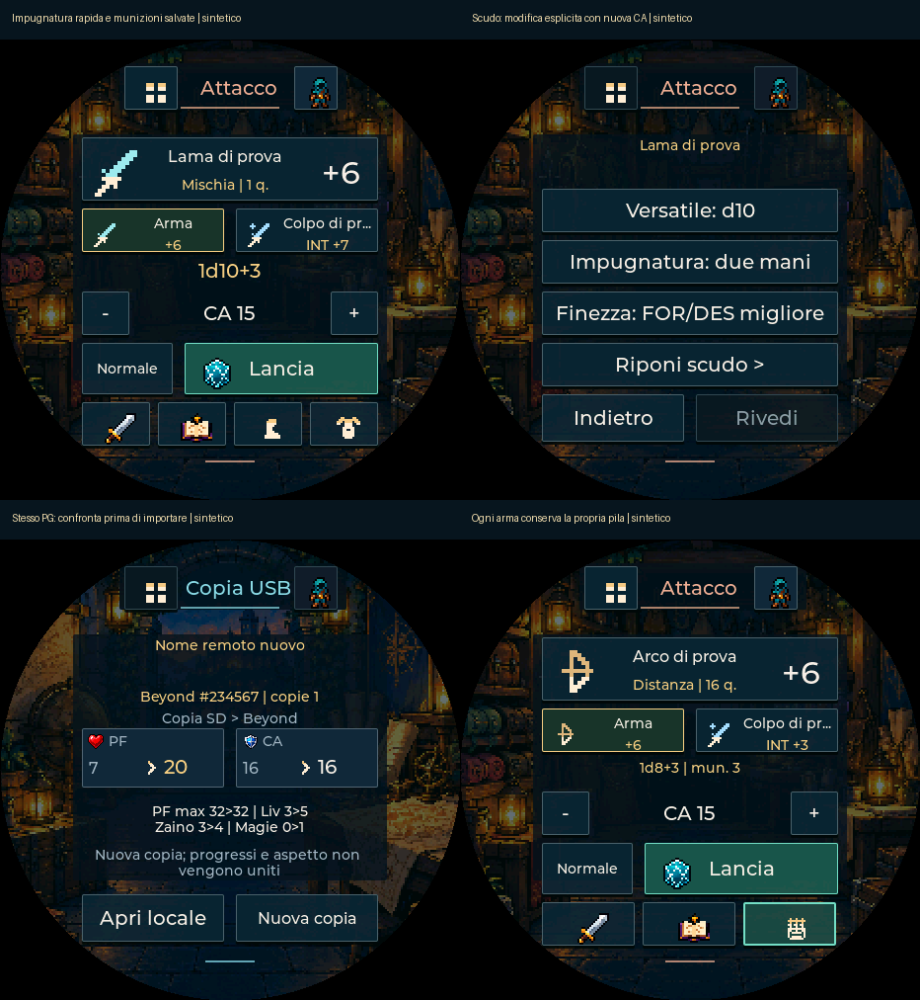

> v0.113: [Due armi, azione bonus e Scalfire](DUE-ARMI-GRAZE.md) aggiunge
> PC v27 / USB24 / PDDh per i nuovi dati. Questa pagina conserva il riferimento v0.112.

# Armi, copie Beyond e prima associazione · v0.112

13 novembre 2026. Il Pocket resta il centro del gioco. Questa versione completa
un blocco di dotazioni e riduce gli equivoci fra nuova importazione e copia locale.
Non è una dichiarazione di copertura universale delle regole D&D.

## Impugnatura dal dispositivo

**Attacca → Dettagli attacco → Impugnatura** apre le proprietà operative dell’arma.
Scegli manuale/una mano, due mani obbligatorie oppure versatile, con dado
alternativo; puoi abilitare Finezza. **Rivedi** confronta attacco/danno prima di
salvare. Le armi versatili hanno anche il comando rapido **1 mano / 2 mani**.
Le impostazioni sono separate per ogni arma e persistono in scheda, backup e SD.

- **Versatile:** il dado alternativo vale solo in mischia usando due mani. La
  modalità Lancio conserva il dado base. Un profilo versatile richiede un solo
  dado base e un dado alternativo maggiore fra d6/d8/d10/d12.
- **Finezza:** usa il migliore fra FOR e DES attuali, FOR in caso di parità.
  Ira usa il bonus solo quando l’attacco soddisfa le regole già rappresentate e
  usa FOR; True Strike conserva la propria caratteristica di lancio.
- **Due mani e scudo:** un tiro incompatibile è bloccato prima di generare dadi
  o spendere munizioni. **Mani** porta alla correzione. **Riponi scudo** apre
  l’anteprima della dotazione con la variazione CA prima della conferma.
  Anche equipaggiare uno scudo o tornare dal Lancio alla mischia rispetta il vincolo.
- Annullare una bozza non modifica la scheda. Errore di salvataggio: riprova
  la stessa proposta; l’Annulla della scheda recupera lo stato precedente.
  I tasti fisici mantengono la navigazione locale nelle nuove conferme.

Nell’app PC le stesse scelte sono in **Inventario e armi → Modifica → Impugnatura
e munizioni**. La conferma è esplicita; le vecchie armi restano manuali finché
non vengono configurate o reimportate con proprietà riconosciute.

## Munizioni conservate per arma

**Attacca → faretra** sceglie una pila separata. Confermare una pila diversa
salva il collegamento, senza consumare quantità né generare dadi. Indietro
conserva la scelta precedente; **Senza consumo** salva il ritorno alla gestione
manuale. Dopo riavvio, cambio arma o apertura della copia SD ogni arma ritrova
la propria pila. Una scelta già identica non riscrive il salvataggio.

Il consumo resta **una unità per tiro per colpire**, anche sul mancato e con
True Strike. Il costo e il d20 seguono la stessa conferma; danni, critici e
consultazione non spendono di nuovo. Una pila vuota o non più idonea blocca il
tiro: non si passa a una fonte diversa o a un tiro gratuito. Una fonte cambiata
durante la sessione richiede una nuova scelta. Ripetere un salvataggio fallito
conserva il d20; un errore del registro non rimborsa e non duplica il costo.
L’Annulla riguarda l’ultima modifica salvata: anche cambiare pila è ora una modifica.

Non si deduce la compatibilità arco/frecce dal nome. Bonus delle munizioni
magiche, recupero, Loading/ricarica, consumi diversi da uno e consumo delle armi
lanciate restano manuali. Due armi, maestrie e altre proprietà speciali restano
da implementare. Non vengono automatizzati i limiti di azioni o le mani degli incantesimi.

## Quali proprietà riconosce Beyond

Per le armi già convertibili, il convertitore legge le proprietà strutturate
con ID positivo e nome canonico **Two-Handed**, **Finesse**, **Versatile**. Il dado
versatile deve avere la forma completa `1d6`, `1d8`, `1d10` o `1d12`, coerente
col dado base. Non cerca parole nelle descrizioni. Homebrew, dati ambigui,
proprietà duplicate/incompatibili e override non riconciliati restano manuali
con avviso. L’importazione non sceglie automaticamente una pila di munizioni.

Uno scudo già importato con un’arma a due mani non viene riposto di nascosto:
i valori restano consultabili e l’attacco richiede la correzione esplicita.

## Reimportare lo stesso PG senza perdere i progressi

I nuovi import salvano soltanto l’**ID numerico del personaggio** come provenienza,
non le credenziali dell’account. L’ID segue backup nativo e copie SD. Le vecchie
copie senza questo dato non sono abbinate per nome: per esse il confronto
automatico richiede una nuova copia importata con questa versione.

Se l’anteprima USB o Wi-Fi ha lo stesso ID della scheda attiva o di una copia SD,
prima di salvare appare un confronto: PF, CA, PF massimi, livello e quantità di
voci nello zaino e nelle magie. Non è un confronto di ogni singola proprietà.

- **Tieni locale:** chiude l’importazione e conserva la scheda attiva.
- **Apri locale:** se il PG è in un altro slot SD, apre la normale anteprima di
  quella copia; la scheda uscente passa dal checkpoint della raccolta. L’apertura
  richiede ancora conferma. Non importa i nuovi dati Beyond.
- **Nuova copia**, con SD: conferma un import separato. Le copie precedenti e i
  loro progressi/aspetto restano conservati dal percorso della raccolta.
- **Sostituisci**, senza SD: avvisa che rimane una sola scheda attiva. Conserva
  prima un backup se vuoi mantenere anche quella uscente.

Nessun aggiornamento remoto o fusione automatica di PF, risorse, aspetto e
progressi. Una modifica della scheda mentre il confronto è aperto rende la
proposta superata e impedisce di applicarla. Il conteggio delle copie non unisce
PG omonimi con ID diversi. La ricevuta USB arriva solo dopo il salvataggio finale.

## Associare Beyond: dal sito al display

1. Aggiorna firmware con **Conserva dati** e componente Pocket PC. Accedi a
   Beyond in Chrome/Edge e connetti il Pocket al Wi-Fi.
2. Dal [sito](https://shydanrem.github.io/PocketD-D/) premi **Associa Beyond**:
   apre direttamente la sezione giusta nell’estensione. Se manca o è vecchia,
   il sito mostra come aggiungerla/aggiornarla e ricaricarla.
3. **Consenti accesso a Beyond** alla prima autorizzazione, poi **Collega Beyond**.
   Scegli la porta quando richiesto, confronta il codice, scegli se ricordare
   l’accesso e conferma **sul Pocket**. I tre passi nella pagina mostrano dove sei.
4. Attendi **Beyond collegato**: compare solo dopo la ricevuta finale del
   dispositivo. Poi dal Pocket scegli **I miei PG → Beyond**, nome, anteprima e
   conferma. PC ed estensione possono essere chiusi per l’uso autonomo via Wi-Fi.

Il sito non riceve sessioni o schede. L’estensione resta necessaria per associare
l’account; la porta è riusata per SD e backup nella stessa pagina. Un vecchio
componente che non riconosce l’ingresso diretto richiede aggiornamento, senza
fingere un’associazione. Sessioni scadute/revocate richiedono ricollegamento.
Memoria dell’accesso opzionale e NVS non cifrata: dettagli nella
[guida Beyond](COLLEGAMENTO-BEYOND.md). Nessuna scrittura verso Beyond.

## Compatibilità e aggiornamento

Aggiorna firmware, app PC e componente dallo stesso rilascio **0.112.0**.
Mantieni **Conserva dati**. Nessuna modifica delle partizioni o dei look SD;
non occorre reimportare i PG per continuare a usarli.

| Dato | Formato minimo nuovo |
| --- | --- |
| Backup dell’app con proprietà operative | PC v26; senza queste resta il formato precedente pertinente |
| Trasferimento con proprietà o provenienza Beyond | USB23; nessun downgrade che perda i dati |
| Record nativo con proprietà o provenienza | PDDg, massimo 77.501 byte |
| Diagnosi pubblica del firmware | USB23 / capacità stato42; controlli PC e SD allineati |
| Backup USB / indice libreria | Contenitore v1 / PDL1 invariati, con nuovo record interno |

I record precedenti sono leggibili; senza metadati nuovi la codifica nativa
mantiene il vecchio formato e i vecchi byte. L’ID origine nel modello PC usa
l’informazione d’importazione già esistente. Un firmware precedente non può
ricevere USB23; un’app precedente può non leggere PDDg: usa il rilascio aggiornato.
I vecchi backup restano conservabili. PG, raccolta, tasti e credenziali non
vengono azzerati dall’aggiornamento del firmware.

## Verifiche e confini reali

Verifiche software: 373 test JavaScript; suite C generale e 167 viste native;
8.000 combinazioni indipendenti di impugnatura/statistiche/scudo/lancio;
32 casi PC → USB23 → C → backup, compresi ID sorgente e rifiuti di metadati
malformati. ASan/UBSan su motore e percorsi LVGL di impugnatura, munizioni e
copie; compilazione ESP32-S3 con partizione invariata, circa 149 KiB liberi.
Browser reale con servizi/USB/permessi sintetici per associazione e editor PC.
La galleria usa il renderer di produzione e personaggi inventati.

Questi test verificano conversione e comportamento sui casi coperti, non soltanto
HTTP. Non costituiscono una nuova lettura reale di Beyond né un login ESP32 reale.
Nessuna modifica a raccolte personali, nessun JSON completo o segreto pubblicato.
Il collaudo con account/PG privato, Wi-Fi, USB, riavvio e interruzioni fisiche
rimane distinto dalle prove sintetiche e dai precedenti riscontri dell’utente.
