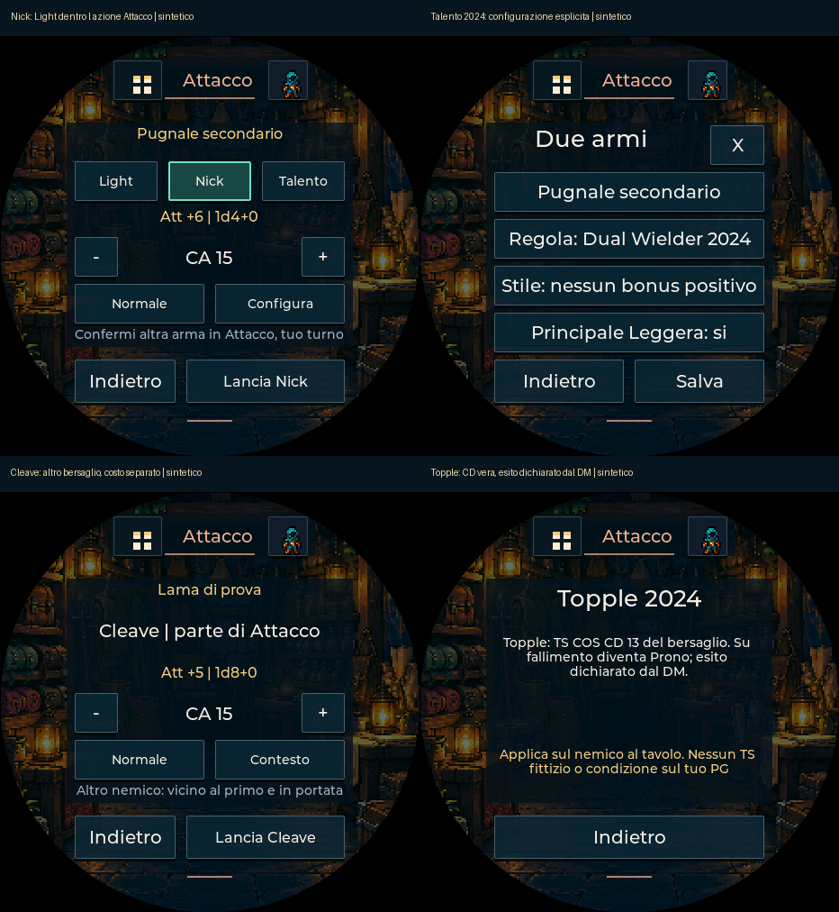

# Nick, Dual Wielder e maestrie · v0.114

13 novembre 2026. Il Pocket amplia il combattimento, mantenendo esplicita la
distinzione fra calcoli automatici e conseguenze da applicare sul nemico al tavolo.

## Nick e attacco da talento: due risorse diverse

**Attacca → dettagli → Impugnatura** permette di scegliere una maestria 2024
per l’arma. Scorri **Maestria**, controlla **Rivedi**, poi **Salva**. Questa scelta
dichiara una concessione del PG: non assegna una capacità dal nome dell’arma.
La seconda arma deve avere Nick e le due armi devono soddisfare Light per il
percorso Nick implementato. Una sola maestria operativa per arma.

In **Due armi**, il comando **Regola** passa fra base 2014, Light 2024 e
**Dual Wielder 2024**. Con quest’ultimo dichiari di possedere il talento e i suoi
prerequisiti. La principale deve essere Leggera; la secondaria può essere una
diversa arma da mischia non Leggera, senza impugnatura a due mani. Il Pocket non
aggiunge incrementi di caratteristica o altri benefici del talento: i valori
importati possono già comprenderli. Quick Draw e il talento 2014, compreso il
relativo bonus CA, restano da gestire separatamente.

Da **Secondaria** scegli uno dei tre percorsi:

| Percorso | Requisiti rappresentati | Spesa alla conferma |
| --- | --- | --- |
| **Light** | Attacco con l’altra arma nell’azione Attacco di questo turno; entrambe Leggere | Extra Light e azione bonus |
| **Nick** | Stesso requisito, regola 2024 e Nick nella secondaria | Extra Light; bonus conservata |
| **Talento** | Dual Wielder 2024 dichiarato, principale Leggera e diversa secondaria da mischia a una mano | Extra del talento e azione bonus |

Nick e Light consumano lo **stesso** extra, una volta per turno. L’attacco da
talento ha un contatore separato. Nick e talento possono quindi essere usati
nello stesso turno, in entrambi gli ordini, quando hai soddisfatto i requisiti.
Nick resta disponibile anche dopo aver speso la bonus per Ira o una magia.
Ripristinare soltanto la bonus con una correzione DM non libera l’extra Light.

La modalità proposta privilegia Nick disponibile, poi talento disponibile,
poi Light. La scelta del percorso rimane visibile prima di tirare; una riprova
non cambia percorso o d20. La principale resta equipaggiata. Il modificatore
positivo ai danni si aggiunge solo con lo stile configurato; quello negativo
rimane. Munizioni collegate, se presenti, e contatori si salvano insieme, anche
sul mancato. Quantità prima/dopo visibili nel risultato.

Premendo **Lancia** confermi l’attacco precedente con l’altra arma nell’azione
Attacco del tuo turno. Il software non può verificarlo al tavolo. True Strike da
solo non sostituisce questo requisito. Lancio della secondaria, ricarica e mani
richieste da proprietà particolari restano fuori dall’automazione.

## Cleave: un secondo nemico

Configura **Cleave** nell’arma. Dopo un colpo riuscito, il risultato mostra
l’icona **Maestria**. Risolvi prima i danni del colpo originale; poi
**Maestria → Cleave** apre il nuovo attacco con CA e contesto propri.

Confermi che il secondo nemico sia diverso, entro 1,5 m dal primo e nella tua
portata. Il Pocket non controlla posizioni, taglia o PF degli avversari.
Il colpo extra è disponibile una volta per turno, non spende la bonus e non
libera o consuma l’extra Light. Il suo critico usa il normale percorso dei danni.
Il modificatore positivo ai danni è escluso; quello negativo rimane, anche se
hai configurato lo stile delle due armi.

Un Cleave innescato da True Strike usa per il nuovo attacco le statistiche
ordinarie dell’arma: non eredita caratteristica di lancio, correzioni del
trucchetto o dadi radianti. Ira e bonus propri dell’arma conservano i requisiti
del normale motore. Eventuali Hex/Marchio/Punizione seguono le loro conferme
e i loro costi; non sono aggiunti automaticamente al nuovo nemico.

## Maestrie assistite e limiti espliciti

L’icona **Maestria** nei risultati mostra la regola del colpo, senza generare
nuovi dadi o modificare la scheda locale per simulare un nemico.

| Maestria | Comportamento del Pocket |
| --- | --- |
| **Scalfire / Graze** | Sul mancato mostra e registra il solo modificatore usato per attaccare, minimo zero; nessun altro bonus |
| **Nick** | Esegue il percorso Light nell’azione Attacco e conserva la bonus |
| **Cleave** | Esegue l’attacco extra con costo per turno e danni corretti |
| **Push** | Mostra spostamento fino a 3 m, direzione e limite Grande o inferiore; applicazione al tavolo |
| **Sap** | Indica svantaggio al prossimo attacco del nemico, con scadenza all’inizio del tuo prossimo turno; consumo e durata manuali |
| **Slow** | Ricorda il requisito di danni effettivamente inflitti, riduzione di 3 m non cumulabile e scadenza; applicazione manuale |
| **Topple** | Calcola **CD = 8 + competenza + modificatore usato per l’attacco originale**; TS COS ed eventuale Prono dichiarati dal DM |
| **Vex** | Richiede danni effettivi e ricorda vantaggio al prossimo attacco contro lo stesso nemico entro fine del prossimo turno; scelta del vantaggio, consumo e scadenza manuali |

Per Push/Sap/Slow/Topple/Vex il selettore indica **DM**. Non esistono ancora
identità, difese e timer persistenti dei bersagli avversari. Leggere la scheda
Vex non abilita un vantaggio automatico contro qualunque bersaglio. Un mancato
non applica queste maestrie; Scalfire ha il proprio comportamento sul mancato.

## Contatori, salvataggi e aggiornamento

**Turni e reazione → Bonus → nome del contatore** permette di consultare e
correggere separatamente bonus, Light/Nick, talento e Cleave. Il cambio di
contatore conserva i valori salvati; **Salva** applica solo la correzione scelta.
**Inizio del proprio turno → Conferma** recupera i quattro saldi. Fine turno,
round, tempo, turni altrui e riposi non li recuperano implicitamente.

I contatori seguono riavvio, backup nativo e copie SD. Un errore NVS ripropone
lo stesso d20 e gli stessi costi; la registrazione fallita mantiene i costi già
salvati senza duplicarli. Una scheda cambiata rende superata la proposta. L’Annulla
resta relativo all’ultima modifica e non cancella i tiri dal registro.
I risultati ancora soltanto in RAM non vengono recuperati dopo perdita di alimentazione.

Aggiorna firmware e componente Pocket PC alla **0.114.0**, con **Conserva dati**.
Il sito richiede il componente aggiornato anche se quello precedente riconosce
già l’ingresso Beyond. Nessun nuovo look SD o cambiamento delle partizioni.

| Dato | Compatibilità |
| --- | --- |
| Nuove maestrie, talento o nuovi contatori nel modello PC | v28; formati precedenti conservati se i dati sono assenti |
| Trasferimento dei nuovi dati | USB25, senza downgrade che li perda |
| Stato nativo con questi dati | PDDi, massimo 77.509 byte; vecchi record leggibili |
| Diagnosi | USB25 / capacità stato44 |
| Contenitore backup e indice SD | v1 / PDL1 invariati |

L’import Beyond conserva il riconoscimento stretto delle proprietà già coperte.
Nick, altre maestrie e talento richiedono configurazione esplicita: nessuna
concessione ricavata dal nome, dal testo descrittivo o da una proprietà potenziale
senza riconciliare l’effettiva capacità del PG. I testi estesi restano negli estratti concordati.

## Verifiche e seguito

Nuovi controlli: 2.880 combinazioni indipendenti di edizione, concessioni, armi,
modificatori e contatori; 128 confronti PC → USB25 → C → backup, tutte le
combinazioni dei quattro saldi e rifiuto dei metadati malformati. Entrambi gli
ordini Nick/talento, bonus già spesa, Cleave una volta, True Strike separato e
CD Topple verificati. UI nativa, tasti, annullamento, d20 conservato nelle riprove,
nessun finto TS del nemico, sanitizzatori, browser e compilazione ESP32-S3.
Suite generale e margine flash nel [resoconto](STATO-SOFTWARE.md).

Prove e immagini nuove sono **sintetiche**. Nessuna nuova lettura reale Beyond,
scrittura verso Beyond, modifica di raccolte personali o pubblicazione di segreti
e risposte complete di PG. Account privato/Wi-Fi/USB su ESP32 e tenuta dei
salvataggi dopo interruzione fisica restano da collaudare.

Restano automazione dei bersagli e delle relative durate, talento 2014 completo,
Lancio/ricarica, altre eccezioni e capacità, ulteriori profili delle magie e
riconciliazione dei progressi fra Beyond e Pocket. Nessuna fusione o scrittura
automatica verso Beyond è introdotta da questo lavoro.

Riferimenti: [SRD ufficiale](https://www.dndbeyond.com/srd), regole SRD 5.2 di
Wizards of the Coast sotto CC BY 4.0; [dati SRD 2024 consultati](https://github.com/5e-bits/5e-database/blob/main/src/2024/en/5e-SRD-Weapon-Mastery-Properties.json)
e proprietà Light nello stesso repository. Dual Wielder 2024: beneficio di
attacco dichiarato dal giocatore secondo il PHB 2024; gli altri benefici non
sono concessi da questa impostazione. Nessuna dipendenza da questi repository o da Foundry.
