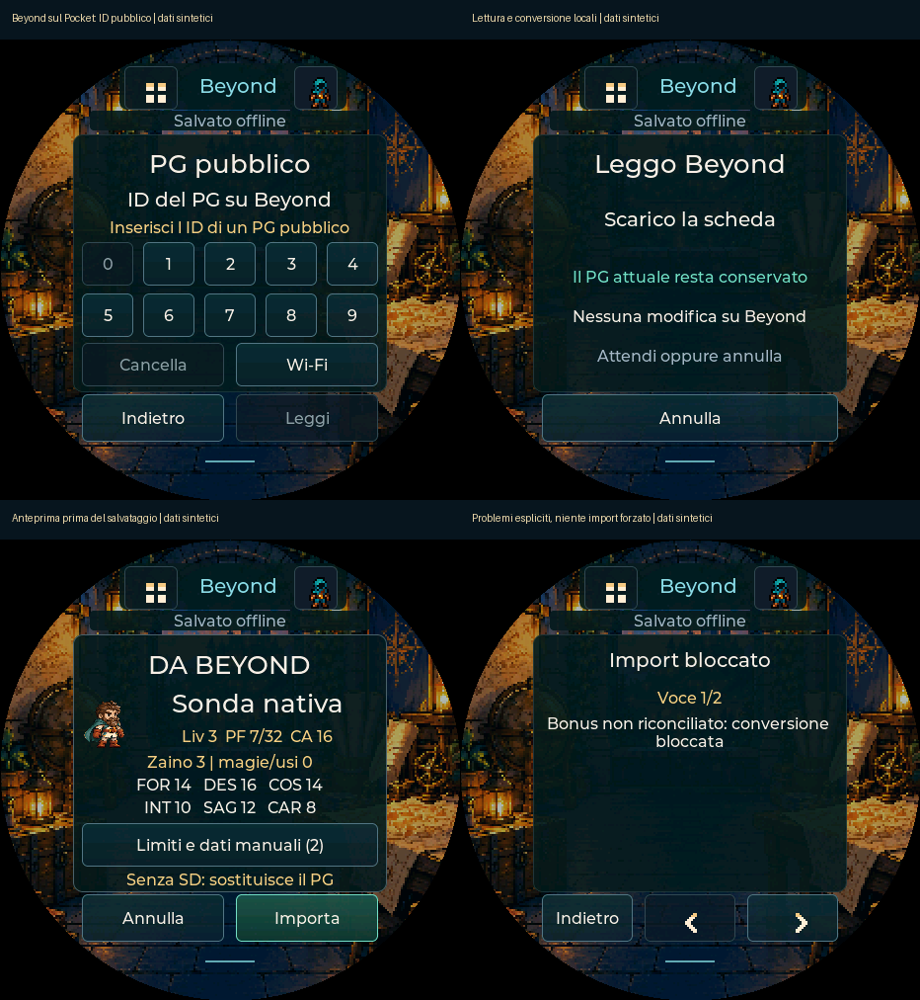

> v0.92: [collegamento account e scelta dei propri PG](COLLEGAMENTO-BEYOND.md) ora implementati; nuovo percorso autenticato da collaudare sull’hardware. Il documento sotto descrive la release pubblica v0.91.

# Beyond direttamente sul Pocket

2 novembre 2026 · v0.91. Il firmware può leggere un **PG pubblico tramite Wi-Fi e
convertirlo sul dispositivo**, senza PC, Foundry o server Pocket. È il primo
percorso nativo: **non è ancora il collegamento all’account** con scelta dei PG
privati. L’elenco completo nell’estensione è già stato confermato dall’utente;
associazione e sessione sul Pocket rimangono il blocco successivo.

## Come provarlo

1. Dal [sito di installazione](https://shydanrem.github.io/PocketD-D/) aggiorna il
   firmware **conservando i dati**. Non reinstallare i look né cancellare la SD.
2. Pocket → **I miei PG** → icona di ricerca in alto a destra → **PG pubblico**. Per questo primo
   percorso serve l’ID numerico finale del link Beyond, per esempio
   `…/characters/123456`. La tastiera accetta solo cifre.
3. Se necessario apri **Wi-Fi**, cerca la rete e inserisci la password sul Pocket;
   torna indietro. Non serve attivare l’hotspot o tenere acceso il PC.
4. Premi **Leggi**. Il Pocket sincronizza l’orologio se necessario, scarica la
   scheda e la converte. Puoi annullare: il PG attuale non cambia.
5. Controlla nome, caratteristiche, PF, CA e conteggi di oggetti e magie/capacità in anteprima.
   **Limiti e dati manuali** apre le note. Un problema bloccante mostra il motivo
   senza offrire una conferma che lo aggiri.
6. **Importa** salva solo dopo la conferma sul display. **Annulla** conserva il PG
   precedente. L’anteprima scade dopo dieci minuti senza conferma.

Con SD e [raccolta locale](LIBRERIA-LOCALE.md) disponibile, prima del cambio si
salva la scheda uscente con progressi e storico. Se la SD è piena, guasta o non
scrivibile, il cambio si blocca. Senza SD rimane una sola scheda attiva: conserva
un backup prima di sostituirla. Le raccolte PC esistenti non vengono toccate.
Un errore di salvataggio dall’esito incerto richiede il riavvio e conserva le
copie disponibili; non viene presentato come importazione completata.

**La nuova lettura Wi-Fi deve ancora essere collaudata sull’hardware.** Il
firmware compila per la scheda supportata e il percorso software è verificato;
non abbiamo ancora misurato TLS, memoria effettiva, fluidità o tempi di questo
nuovo flusso sull’ESP32. Se una richiesta fallisce, basta riferire il messaggio
sul display: non servono JSON, cookie o dump di rete.

## Che cosa è stato verificato

| Controllo | Evidenza e limite |
| --- | --- |
| HTTP pubblico reale | PG `167361077`, servizio Beyond, HTTP 200 e 681.697 byte il 2 novembre; connettore Pocket su PC. Non una richiesta radio ESP32 |
| Formato reale | Risposta JSON con schema e identità attesi; parsing in memoria, nessun file con il JSON completo |
| Valori convertiti | PF **53/53**, CA **16**, FOR/DES/COS/INT/SAG/CAR **15/10/16/8/8/17**, 11 oggetti e 69 magie/capacità. Tutto il record nativo coincide byte per byte con la proiezione PC dagli stessi dati |
| Interpretazione dei valori | La parità prova che il Pocket applica le stesse regole supportate del PC; non dimostra che ogni regola D&D sia automatizzata. Il risultato reale conserva **35 limitazioni/note** e nessun blocco |
| Conversione sintetica | 74 casi, 67 accettati e 7 bloccati; tutti i record accettati identici al PC. Caratteristiche 1–30, livelli 1–20, inventario vuoto/al limite/oltre limite, budget insufficiente |
| Errori del servizio | Codice di produzione con HTTP/orologio/task simulati: TLS configurato, URL fisso, stati HTTP, MIME, dimensioni, lunghezza discordante, risposta troncata, timeout, annullamento anche tardivo, nessun candidato obsoleto |
| Interfaccia e salvataggio | 145 viste LVGL; touch, tasti, ritorno dal Wi-Fi, limiti, blocchi, annullamento, conferma unica, conservazione del vecchio PG ed errore NVS incerto con periferiche simulate |
| Regressioni | 341 test JavaScript e suite native pertinenti; build ESP32-S3. I test sintetici non valgono come collaudo del dispositivo |
| Controlli memoria | ASAN/UBSAN su convertitore, servizio e UI con dati sintetici, senza rilievi. Stack host aumentato solo nella build strumentata per i redzone; il percorso normale verifica il limite di 20 KiB dell’interprete, non lo stack fisico ESP32 |
| Account reale | Elenco completo confermato dall’utente nel browser il 31 ottobre. Nessun cookie/token trasferito al Pocket in questa versione |

I PF reali precedentemente confermati erano **35/53**; la nuova risposta del
servizio riporta **53/53**. La prova è di sola lettura: non ha curato il PG né
modificato Beyond, la raccolta personale o il personaggio sul dispositivo.
Non viene pubblicato il JSON completo e non vengono eseguiti tiri sul PG reale.

## Come funziona la conversione

Il firmware incorpora le **stesse regole JavaScript della conversione PC**,
eseguite in un interprete QuickJS isolato. Si evita di mantenere una seconda
implementazione delle regole in C. Il programma incorporato è costruito da
sorgenti Pocket versionati: il corpo ricevuto da Beyond viene analizzato come
JSON, **mai eseguito come codice**. Nessun modulo di sistema, accesso a file,
rete o generatore di dadi è esposto all’interprete.

Il risultato passa poi attraverso lo stesso parser C rigoroso usato dall’USB.
Il convertitore non salva direttamente alcuna scheda: prepara il candidato che
la UI mostra prima della conferma. I formati PG, USB21/PDDe40, backup e raccolta
PDL1 restano invariati. Preferenze e tasti configurabili del dispositivo sono
conservati. Una nuova importazione è una nuova copia, non sincronizzazione dei
progressi con Beyond.

La normalizzazione della sorgente, prima eseguita due volte nella conversione
completa PC, ora viene eseguita una volta. Su questo PG il picco delle
allocazioni dell’interprete host scende da 3.965.640 a **3.496.664 byte**.
Questo valore esclude sorgente grezza, stack, rete, UI e altri servizi: non è
la memoria totale dell’ESP32 né garantisce che qualsiasi PG entri negli 8 MB.

## Limiti espliciti

- Richiesta GET al solo endpoint HTTPS `character-service.dndbeyond.com`, con
  certificati e nome host verificati; niente redirect, fallback HTTP o scritture.
- Orologio tramite SNTP se necessario; rete assente, orario non disponibile,
  401/403, 404, 429, MIME inatteso e JSON non valido hanno esiti distinti.
- Sorgente al massimo **1 MiB**, interprete al massimo **4 MiB**, task di
  conversione con stack 32 KiB. Orologio: 15 s; download e conversione: 20 s
  ciascuno, con richieste bloccanti limitate a 5 s. Annullamento cooperativo.
- Le note sul display sono un estratto: fino a 64 righe da 160 byte, taglio
  sicuro UTF-8. I conteggi completi restano visibili; nessun blocco viene
  trasformato in successo dal taglio dei testi.
- Il limite di memoria non produce un PG ridotto in silenzio: l’importazione
  viene rifiutata. La SD aumenta lo spazio per look e schede, non la RAM.
- Restano i [limiti della conversione Beyond](BEYOND-V1.md): proprietà o regole
  non rappresentate restano dichiarate/manuali. Non basta HTTP 200 per riuscire.
- Il ponte PC viene sospeso durante la conversione; il parser USB è escluso con
  un mutex anche all’avvio del lavoro, per evitare parsing JSON concorrente.
- Nessun accesso ai PG privati, elenco account sul display o sessione ricordata
  in questa release. Nessuna credenziale in PG, SD, pacchetti o repository.

## Passaggio successivo verso l’obiettivo

Collegare esplicitamente l’account già verificato dal browser al Pocket, con
conferma riconoscibile sul display, gestione di scadenza/rifiuto/revoca e
credenziali separate dai backup PG. Poi leggere l’elenco sul dispositivo e
riusare questa stessa anteprima/conversione per la scelta del PG, incluse le
schede private. Il collegamento non promette una sessione permanente e non
deve compromettere l’uso offline o le copie locali se Beyond non risponde.
