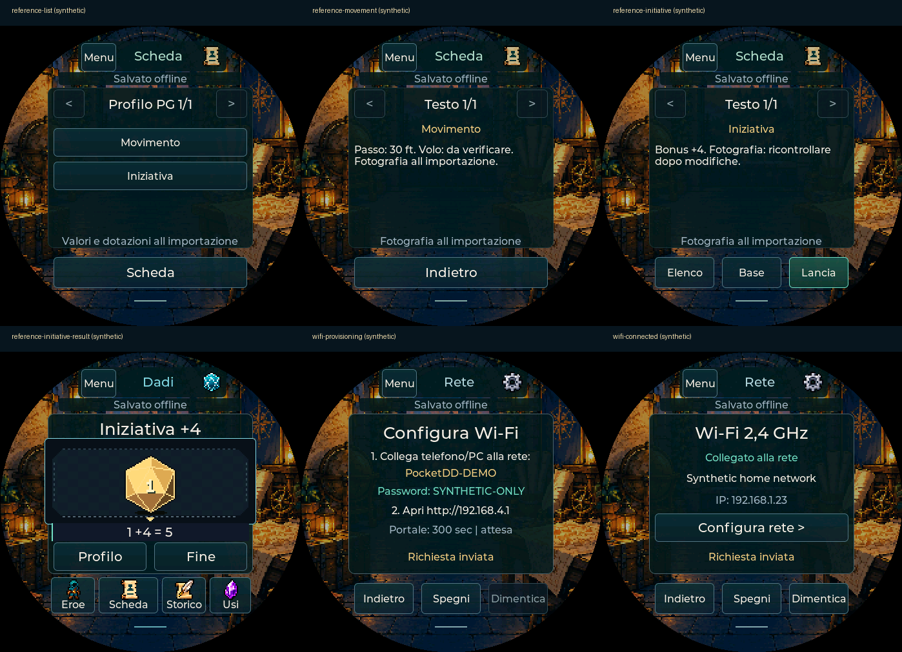

# Beyond: prima versione offline

> v0.89: [Punizione 2024, riconciliazione slot ordinari/patto e prove reali](PUNIZIONE-DIVINA.md).

> Aggiornamento v0.86: [bonus permanenti e sintonia per tutti i PG](OGGETTI-SINTONIA.md).

Aggiornamento v0.85: [equipaggiamento e True Strike 2024 operativi sul Pocket](EQUIPAGGIAMENTO-MAGIE.md).
USB/installer/SD riferiti risolti dall’utente; nuove interazioni da provare sul dispositivo.
Il contratto offline e i limiti descritti sotto restano applicabili, con i profili
0.85 che aggiornano i valori collegati alle proprietà esplicitamente configurate.

28 ottobre 2026. Il prodotto è PocketD-D sul dispositivo; il PC importa e
configura. Questa versione non richiede Foundry. I testi restano negli estratti
concordati: non sono un requisito da riaprire per la prima versione.

## Contratto verificabile

1. Il connettore PocketD-D legge una scheda pubblica senza autenticazione.
2. L’anteprima separa HTTP, formato JSON, calcoli, dati conservati e problemi.
3. La conferma crea **un nuovo PG sul PC**, conservando le altre schede.
4. La proiezione USB è validata prima dell’invio. Sul dispositivo anteprima e
   conferma sostituiscono la sola copia locale; la raccolta PC è conservata.
5. Il PG può essere usato offline e conservato/ripristinato con backup nativo.

`canImport` attesta una bozza validata, non l’avvenuto trasferimento.
`conversion.complete` rimane falso: non è stata automatizzata ogni regola D&D.
`readiness` distingue problemi bloccanti, eccezioni specifiche di quel PG,
regole manuali e fotografie. Le descrizioni tagliate sono estratti accettati,
non errori dei valori. Una magia descritta non equivale a un effetto eseguito.

## Aggiunto e corretto

- **Scheda → Profilo PG**: specie, classi/sottoclassi/livelli, background,
  cinque movimenti, sensi, tre valori passivi, lingue e strumenti riconciliati.
- **Iniziativa**: d20 con il bonus importato, vantaggio/svantaggio scelti,
  Avvelenato ed effetti di tiro configurati attualmente sul dispositivo.
  Se serve, dichiarazione del contesto. Il risultato entra nello storico.
  Bonus condizionali/formule non riconciliati escludono il comando del tiro:
  la scheda spiega di verificare e usare il dado libero.
- **Dotazioni**: equipaggiato, sintonia, peso unitario in libbre e contenitore
  sorgente quando disponibili. `?` significa sconosciuto; zero resta zero.
  Sono fotografie: modificare la quantità nello zaino non aggiorna questi testi.
- Origini dei modificatori verificate per scelte, livello, oggetto equipaggiato
  e sintonia. Duplicati identici non sommano due volte; discordanti mantengono
  il valore interessato da verificare. Formule di movimento non riconciliate
  non producono velocità plausibili ma inventate.
- Movimento: base della specie, valori fissati, bonus numerici supportati,
  corrispondenza con il passo e personalizzazioni standard con ID conosciuto.
  Restrizione del volo senza armature medie/pesanti riconosciuta esattamente.
  Altri requisiti restano espliciti. Condizioni, carico e terreno sono al tavolo.
- Sensi: valori di base/fissati, bonus numerici, caso esplicito dei +60 ft di
  scurovisione e override standard. Passivi calcolati dalle abilità riconciliate;
  restano fotografie. Sensi speciali con regole diverse sono da verificare.
- Azioni e magie con lo stesso ID/origine vengono deduplicate se identiche.
  Saldi discordanti interrompono l’importazione: non creano riserve doppie.
- Corretto il riconoscimento dei modificatori principali: `unarmored-movement`
  non viene scambiato per un modificatore della CA. La velocità coinvolta resta
  manuale se la sua regola non è riconciliata.
- Resoconto specifico del personaggio al posto delle sole omissioni generiche;
  consultazione del profilo anche nel pannello Stato, risorse e note del PC.

## Ambito manuale dichiarato

PF/CA, iniziativa e dati del profilo non vengono ricalcolati automaticamente
quando cambiano livello, caratteristiche o equipaggiamento. Un tipo di difesa
assente resta sconosciuto: completamento solo dopo verifica e conferma.

Gli utilizzi espliciti, slot ordinari/patto, risorse supportate, cariche e
consumabili mantengono i comandi già disponibili. Contatori manuali, riserve
condivise o costi/formule non riconosciuti non ricevono collegamenti inventati.
Azioni da oggetto con usi non duplicano le cariche. Il cannone riconosciuto ha
il costo gratuito/slot della v0.77; PF, durata, forma e modalità sono manuali.

Restano manuali effetti generali di magie/talenti, bersagli, attacchi speciali,
versatilità/due armi/maestrie, munizioni, immunità alle condizioni, sintonia e
peso/contenitori operativi. Le azioni personalizzate sono note, senza tiri
inventati. Origini opzionali e formule sui valori principali non supportate
possono ancora bloccare la conversione. Questa è una copertura finita per una
prima versione, non una promessa su ogni scheda/homebrew.

## Formati e conservazione

- Backup PC **v20** solo quando sono presenti pagine del profilo; i precedenti
  formati restano leggibili. La raccolta non viene riscritta preventivamente.
- **USB17 / firmware 0.78** per questi dati; copie precedenti ancora accettate.
  Aggiornare l’app PC insieme al firmware prima di reimportare.
- Stato nativo **PDD36 / `PDDa`**, sempre **75.204 byte** al massimo, senza nuove
  partizioni o crescita del record. Lettura dei formati precedenti mantenuta.
- Le pagine usano voci informative contrassegnate, escluse dal catalogo di
  magie/capacità operative. Non consumano utilizzi e non sono lanciabili.
- Limite complessivo **120** voci, comprese le pagine; oltre il limite si ferma
  la conversione senza tagliare voci. Inventario massimo 60 righe.
- Wi-Fi in memoria separata: nessuna password nei pacchetti o backup del PG.

## Evidenza e collaudo aperto

Lettura reale 28 ottobre 2026 del PG **144777811**, con connettore esistente:
HTTP 200, 426.718 byte, formato valido. FOR/DES/COS/INT/SAG/CAR
**8/18/14/18/10/10**, PF **32/73**, CA **17**, **41** voci d’inventario.
I valori e tutte le quantità coincidono nel parser C; **14** pagine del profilo
(64 voci complessive) passano parser/codec C con chiavi, iniziativa e CRC dei
relativi testi identici alla proiezione PC.

Dal sorgente riconciliato: passo **30 ft**, volo **30 ft** subordinato alla
restrizione dell’armatura; scurovisione **60 ft**; passivi Percezione/Intuizione/
Indagare **14/10/14**; iniziativa **+4**. Nessuna automazione aggiuntiva viene
attribuita alle note. Più armi equipaggiate richiedono la scelta dell’arma attiva;
azioni custom, oggetti generici e alcuni dati di dotazione restano da verificare.

Questa verifica confronta dati ricevuti e conversione, non una schermata Beyond
autenticata. Le prove di varianti, duplicati, errori e limiti sono **sintetiche**.
Nessuna raccolta personale aperta/modificata, nessun JSON sorgente completo
pubblicato, nessuna scrittura Beyond e nessun invio USB durante queste prove.

**Non chiuso:** importazione fisica del tuo PG, conferma sul display, riavvio e
ripristino. Il precedente problema USB resta aperto. Anche connessione Wi-Fi,
riaggancio, sospensione e consumo devono essere collaudati sul dispositivo.

## Controlli riproducibili

- `npm test`: 265 test JS, inclusi formati/omissioni/duplicati del profilo.
- `IDF_PATH=... npm run firmware:test`: suite C, NVS/backup, 48 sorgenti
  sintetici profilo→USB17→C e 7 pacchetti rifiutati; 322 stati nativi del profilo.
- `python3 scripts/check-beyond-reference-ui.py`: nuova importazione isolata,
  raccolta precedente intatta, reload, profilo e copia USB17, anche su mobile.
- `python3 scripts/check-wifi-portal.py`: HTML reale del portale con backend
  simulato; modulo WPA2/aperto, errori, nessuna vecchia conferma riutilizzata.
- Servizio Wi-Fi con SDK simulato e parser con 20.000 corpi malformati.
- Interfaccia LVGL: 123 schermate; verifiche con AddressSanitizer/UBSan.
- Compilazione ESP-IDF 5.5.5 per ESP32-S3; nessun test fisico implicito.

