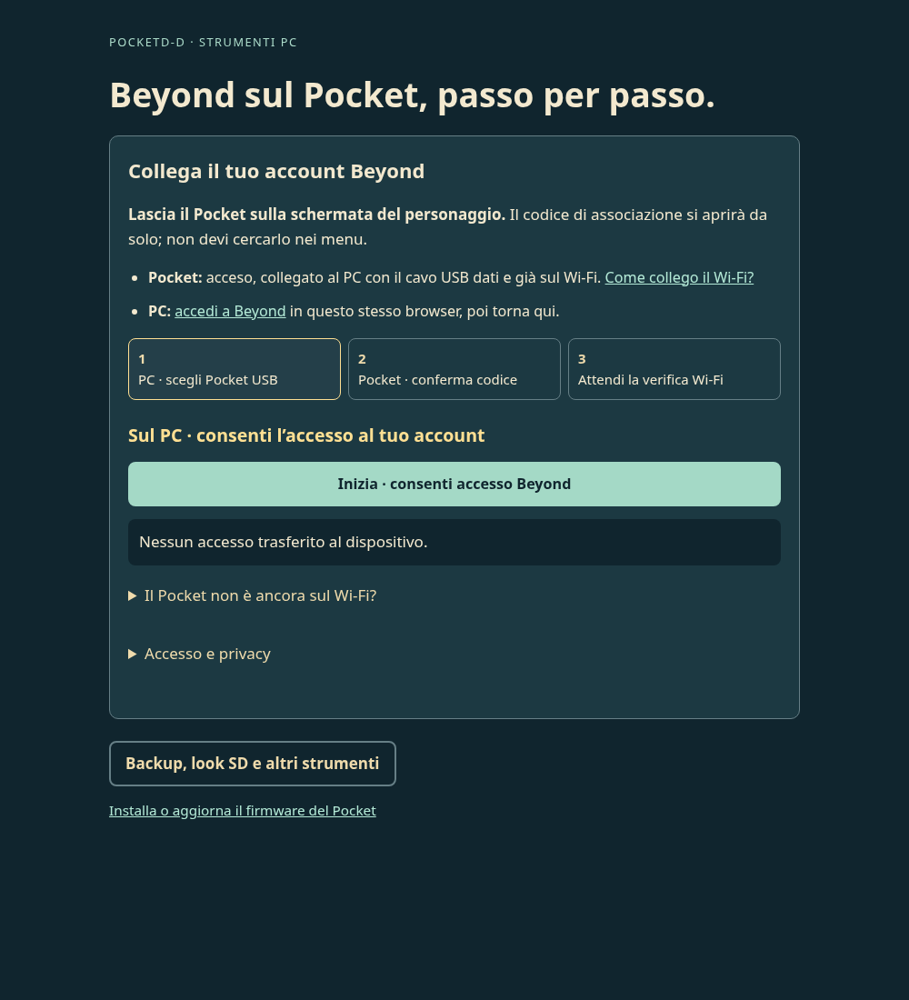
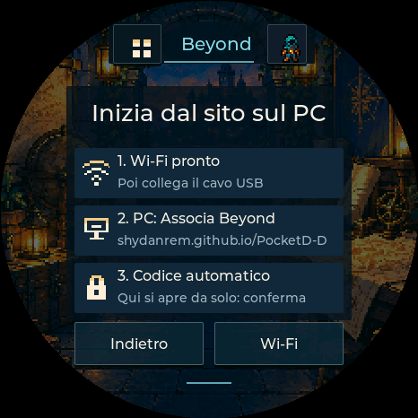

# Collega Beyond al Pocket una volta

**16 novembre 2026 · v0.116.** Parti da questa pagina sul **PC**:
[Associa Beyond](https://shydanrem.github.io/PocketD-D/#beyond).
**Non devi cercare un comando di associazione sul dispositivo.** Il codice si
apre automaticamente sul Pocket quando avvii il collegamento dalla pagina PC.

## Prima volta: segui questo percorso

1. **Pocket:** acceso e sul Wi-Fi. Se manca la rete, apri **Menu → ingranaggio →
   Wi-Fi → Cerca reti**, scegli la rete e inserisci la password. Poi lascia
   aperta la schermata del personaggio e collega il cavo USB dati al PC.
2. **PC, Chrome o Edge:** [accedi a Beyond](https://www.dndbeyond.com/my-characters)
   nello stesso browser. Dal [sito Pocket](https://shydanrem.github.io/PocketD-D/#beyond)
   premi **Associa Beyond**.
3. **Se manca l’estensione**, il sito mostra i passaggi: scarica ed estrai lo ZIP,
   apri `chrome://extensions` o `edge://extensions`, attiva **Modalità sviluppatore**,
   premi **Carica estensione non pacchettizzata**, scegli la cartella `extension`.
   Alla prima installazione si apre già la pagina Beyond. Se non compare,
   torna al sito e premi **Ho aggiunto l’estensione · continua**. Se la pagina si
   ricarica, continua automaticamente verso la pagina richiesta quando rileva
   l’estensione; se non la rileva mostra cosa controllare. Non serve il pacchetto PC completo.
4. **Nella pagina che si apre**, autorizza **Inizia · consenti accesso Beyond**
   se compare, poi **Scegli Pocket USB e collega**. Seleziona la porta del Pocket.
   Il permesso e la scelta della porta sono richieste del browser distinte.
5. **Adesso guarda il Pocket:** confronta le sei cifre con quelle sul PC. Lascia
   **Ricorda accesso: SI** per poterlo usare dopo il riavvio senza PC, oppure
   scegli NO per il solo accesso temporaneo. Premi **Collega sul display**.
6. **Attendi Beyond collegato sul PC.** Il Pocket verifica account ed elenco via
   Wi-Fi e, se scelto, salva/rilegge l’accesso. Solo la ricevuta finale conferma
   l’associazione. A quel punto puoi scollegare il PC.

La pagina distingue **Sul PC**, **Sul Pocket** e **Attendi**; durante il codice
nasconde preparazione e pulsanti d’avvio. Backup, look SD e controlli tecnici si
aprono con **Backup, look SD e altri strumenti**, fuori dal percorso principale.
Anche il popup dell’estensione ha il pulsante **Associa Beyond**: il codice a
nove cifre del ponte sperimentale è un altro collegamento e qui non serve.

### Se non va avanti

- **Non sai dove iniziare:** usa il link in cima su Chrome/Edge del PC. Sul
  dispositivo basta lasciare aperta la schermata del personaggio.
- **Estensione non rilevata:** controlla di aver caricato la cartella estratta,
  non lo ZIP. Ricarica la pagina del sito dopo averla installata.
- **Estensione vecchia:** sostituisci i file nella sua cartella `extension`, premi
  **Ricarica** nella gestione estensioni, poi ricarica il sito. Non rimuovere
  dati o configurazioni sul Pocket.
- **Porta occupata o assente:** chiudi installer, app PC, altre schede Pocket e
  monitor seriali. Collega un cavo dati e riprova dalla stessa pagina.
- **Richiesta di accesso Beyond:** accedi nello stesso browser, poi riprova.
- **Codice sul Pocket ma manca il Wi-Fi:** con firmware 0.116 premi **Wi-Fi**
  sul display, collega la rete e premi **Wi-Fi pronto · riprova** sul PC. Il
  vecchio codice viene chiuso; confronta e conferma quello nuovo. Con firmware
  precedente annulla il codice e collega la rete dalle impostazioni.
- **Porta sbagliata o altro Pocket:** usa **Cambia Pocket USB** nella pagina
  Beyond, poi scegli la porta. Dopo un successo usa **Collega un altro Pocket**.
- **Errore dopo la conferma:** dalla 0.116 il browser indica il motivo e l’azione
  utile: login, Wi-Fi/Internet, orologio, salvataggio o altro. Il salvataggio non
  confermato richiede il controllo del display e un riavvio prima di riprovare.
- **Nessuna ricevuta finale:** associazione non confermata; leggi il messaggio
  sul Pocket. La lettura del solo elenco nell’estensione non associa l’account.

La porta verificata viene riutilizzata nella stessa pagina. Il confronto scade
dopo due minuti; dopo la conferma l’invio deve partire entro 30 secondi.
Annullare non dichiara annullato un collegamento eventualmente già salvato.

## Cosa è verificato in questa revisione

[Report della revisione](REVISIONE-USO-V116.md). Pagina HTML/JS reale in Chromium: partenza senza permessi, login
mancante, ritorno al percorso, annullamento e riprova, codice e ricevuta finale,
strumenti secondari nascosti/apribili, nessun segreto in DOM/localStorage e
larghezze 1000/390/320. Il sito è verificato con estensione assente, vecchia e
corrente; Continua apre direttamente la vista Beyond quando la rileva.
**Cookie, HTTP, browser-extension API e seriale sono simulati.** Le viste native
usano servizi simulati; la compilazione ESP32 non prova il funzionamento RF/USB.
L’utente riferisce di non trovare l’inizio: nessuna nuova associazione reale o
lettura privata sul Pocket è stata confermata. HTTP, formato, conversione e
ricevuta del dispositivo rimangono verifiche distinte.

## Uso autonomo

Pocket → **Menu → I miei PG → Beyond**: il pulsante Beyond è scritto per esteso anche quando la raccolta contiene già personaggi. Se l’accesso è ricordato ma l’elenco
non è in RAM, si prova a caricarlo quando il Wi-Fi è pronto. Altrimenti **Rileggi**
carica/aggiorna l’elenco. Scegli il nome, attendi lettura/conversione, controlla
caratteristiche, PF, CA e limiti, quindi **Importa**. Non serve lasciare il PC,
l’estensione o il ponte locale accesi.

Le righe mostrano nome abbreviato, livello e ultime cifre dell’ID per distinguere
omonimi. Un elenco che il servizio dichiara parziale viene indicato come tale;
non si ripiega sui personaggi delle campagne e non si inventa completezza.
Il PG selezionato viene letto con un bearer appena ottenuto per lo stesso account.
Non si ripiega sulla lettura anonima se l’autenticazione fallisce.

L’importazione riusa la [conversione nativa e la conferma](BEYOND-DISPOSITIVO.md).
Con SD, la raccolta salva la scheda uscente prima di cambiarla; senza SD rimane
un solo PG attivo. Non sincronizza automaticamente progressi, PF, slot o aspetto
con Beyond. Offline puoi aprire i PG locali e giocare senza il servizio.

## Ricordare o rimuovere l’accesso

- **SI:** cookie di sessione e identità attesa sono salvati nella NVS del Pocket,
  in una chiave e namespace dedicati (`pdd_nvs/pdd_beyond/access`), con rilettura
  di verifica. Il bearer resta temporaneo in RAM; viene rinnovato a ogni richiesta.
- **NO:** il collegamento resta in RAM fino allo spegnimento. Un vecchio accesso
  persistente viene rimosso prima di confermare quello temporaneo, così non
  ricompare un altro account al riavvio.
- La memoria flash/NVS attuale **non è cifrata**. Chi può leggerla fisicamente può
  recuperare l’accesso ricordato. Non vengono attivate cifratura o eFuse durante
  l’aggiornamento. Il codice e il trasporto USB non offrono protezione contro
  un PC o firmware compromesso.
- Il cookie **non ha privilegi ridotti**: è una sessione del proprio account.
  Pocket esegue solo login tecnico e letture, ma il segreto va protetto come
  l’accesso al sito. Non copiarlo in messaggi, file, screenshot o diagnostica.
- Schede, raccolta SD, backup PG USB, pacchetti e repository non contengono queste
  credenziali. Un dump integrale della flash comprende invece anche la NVS.
- In Beyond sul Pocket: **Esci → Scollega** rimuove l’accesso e l’elenco in RAM,
  senza cancellare PG, progressi, Wi-Fi o il login del browser. Se il salvataggio
  o la rimozione hanno esito incerto, le operazioni account si bloccano fino al riavvio.
- Il collegamento non è permanente: sessioni scadute/revocate, 401/403 o cambi di
  account possono richiedere una nuova associazione. Un errore di rete non
  cancella le copie locali e non viene chiamato importazione riuscita.

## Controlli e limiti

| Parte | Verifica effettuata |
| --- | --- |
| Login/elenco reale browser | L’utente ha confermato elenco completo il 31 ottobre con l’estensione precedente. Non è una prova del nuovo trasferimento cookie |
| Preparazione/USB browser | Test JS e pagina Chromium con API cookie/serial/permessi simulate: consenso, cookie fisso, identità, cambio login, scadenza, codice prima del segreto, conferma, ricevuta finale e rifiuti; nessun segreto in DOM/localStorage |
| Protocollo/archiviazione C | Grammatica stretta e 20.000 richieste malformate, JWT/identità/scadenza, duplicati/schema, salvataggio/rilettura/rimozione del solo namespace con NVS simulata |
| Servizio nativo | Codice reale con HTTP/task simulati: cookie solo verso auth, bearer solo verso character-service, account atteso, elenco, lettura privata sintetica, RAM/persistenza, errori, annullamento tardivo e commit incerto |
| UI | 173 viste LVGL, compresi pulsante Beyond nella raccolta, guida Wi-Fi/sito, confronto codice, scelta memoria, elenco e scollegamento. PG e progressi invariati dall’associazione |
| Conversione | Stesso convertitore della v0.91, parità su sorgente pubblica reale già verificata; nessuna nuova lettura privata reale in questa release |
| Hardware | Nuovi cookie MV3, handshake USB, POST autenticato ESP32, elenco e PG privati reali, persistenza dopo riavvio e prestazioni **ancora da provare** |

HTTPS con verifica certificato/nome host e senza redirect: cookie al solo
`auth-service.dndbeyond.com/v1/cobalt-token`, bearer agli endpoint account/scheda
su `character-service.dndbeyond.com`. Identità e scadenza vengono lette dal token
ricevuto da quell’origine HTTPS; non è una verifica indipendente della firma JWT.
Nessun servizio Pocket cloud o Foundry obbligatorio e nessuna scrittura dei PG su Beyond.

Limiti: cookie 4 KiB, risposta auth 32 KiB, bearer 16 KiB, elenco 512 KiB/300 PG,
nomi/dettagli abbreviati con UTF-8 valido, profondità JSON account 32. Oltre limite
si rifiuta il risultato; la conversione della scheda mantiene i budget v0.91.
Gli endpoint non sono un contratto OAuth pubblico: la fattibilità reale dipende
anche dalla risposta Beyond all’ESP32. Non si aggirano verifiche del servizio.
