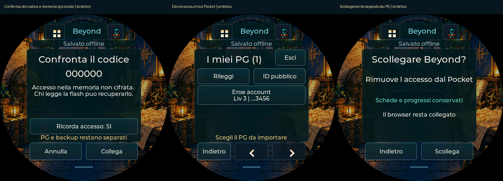

> v0.93: interfaccia PC semplificata, stessa autenticazione nativa v0.92; prove reali sul dispositivo ancora da eseguire.

# Collega Beyond al Pocket una volta

2 novembre 2026 · v0.92 · **percorso sperimentale, da collaudare sull’hardware**.
Il codice ora comprende associazione dell’account, elenco sul Pocket e lettura
anche autenticata delle schede. Le nuove prove usano sessioni e risposte
sintetiche: non attestano un login reale ESP32 o la lettura reale di un PG privato.

## Prima associazione, flusso semplificato v0.93

1. Sul Pocket serve firmware **0.92 o successivo**. Dal [sito](https://shydanrem.github.io/PocketD-D/)
   puoi aggiornarlo conservando i dati, poi **Apri Pocket PC**. Se manca il componente,
   segui i passaggi iniziali mostrati dal sito per caricare l’estensione Chrome/Edge.
2. Accedi a Beyond nello stesso browser e collega il Pocket al Wi-Fi.
3. In Pocket PC premi **Collega Beyond**. La prima volta autorizza prima
   **Consenti accesso a Beyond**. Non occorre una preparazione separata.
4. Scegli la porta se necessario e confronta il codice sul PC e sul display.
   Scegli **Ricorda accesso: SI/NO**, poi **Collega** sul Pocket. Solo dopo la
   conferma fisica parte il trasferimento dell’accesso.
5. Attendi **Beyond collegato** nel browser e l’elenco sul Pocket. Il dispositivo
   verifica identità ed elenco via Wi-Fi e, se scelto, salva/rilegge l’accesso.
   Solo la ricevuta finale conferma l’associazione. Puoi chiudere il PC.

La porta riconosciuta viene riutilizzata per Beyond, SD e backup nella stessa
pagina. Il controllo dettagliato del solo elenco è facoltativo. La preparazione
automatica dell’accesso resta temporanea: confronto entro due minuti, poi invio
entro 30 secondi dalla conferma. Annullamento e commit tardivi non fingono di
rimuovere un collegamento già salvato. [Guida Pocket PC](POCKET-PC.md).

## Uso autonomo

Pocket → **I miei PG → lente** apre Beyond. Se l’accesso è ricordato ma l’elenco
non è in RAM, si prova a caricarlo quando il Wi-Fi è pronto. Altrimenti **Rileggi**
carica/aggiorna l’elenco. Scegli il nome, attendi lettura/conversione, controlla
caratteristiche, PF, CA e limiti, quindi **Importa**. Non serve lasciare il PC,
l’estensione o il ponte locale accesi.

Le righe mostrano nome abbreviato, livello e ultime cifre dell’ID per distinguere
omonimi. Un elenco che il servizio dichiara parziale viene indicato come tale;
non si ripiega sui personaggi delle campagne e non si inventa completezza.
Il PG selezionato viene letto con un bearer appena ottenuto per lo stesso account.
Non si ripiega sulla lettura anonima se l’autenticazione fallisce.

L’importazione riusa la [conversione nativa e la conferma](BEYOND-DISPOSITIVO.md).
Con SD, la raccolta salva la scheda uscente prima di cambiarla; senza SD rimane
un solo PG attivo. Non sincronizza automaticamente progressi, PF, slot o aspetto
con Beyond. Offline puoi aprire i PG locali e giocare senza il servizio.

## Ricordare o rimuovere l’accesso

- **SI:** cookie di sessione e identità attesa sono salvati nella NVS del Pocket,
  in una chiave e namespace dedicati (`pdd_nvs/pdd_beyond/access`), con rilettura
  di verifica. Il bearer resta temporaneo in RAM; viene rinnovato a ogni richiesta.
- **NO:** il collegamento resta in RAM fino allo spegnimento. Un vecchio accesso
  persistente viene rimosso prima di confermare quello temporaneo, così non
  ricompare un altro account al riavvio.
- La memoria flash/NVS attuale **non è cifrata**. Chi può leggerla fisicamente può
  recuperare l’accesso ricordato. Non vengono attivate cifratura o eFuse durante
  l’aggiornamento. Il codice e il trasporto USB non offrono protezione contro
  un PC o firmware compromesso.
- Il cookie **non ha privilegi ridotti**: è una sessione del proprio account.
  Pocket esegue solo login tecnico e letture, ma il segreto va protetto come
  l’accesso al sito. Non copiarlo in messaggi, file, screenshot o diagnostica.
- Schede, raccolta SD, backup PG USB, pacchetti e repository non contengono queste
  credenziali. Un dump integrale della flash comprende invece anche la NVS.
- In Beyond sul Pocket: **Esci → Scollega** rimuove l’accesso e l’elenco in RAM,
  senza cancellare PG, progressi, Wi-Fi o il login del browser. Se il salvataggio
  o la rimozione hanno esito incerto, le operazioni account si bloccano fino al riavvio.
- Il collegamento non è permanente: sessioni scadute/revocate, 401/403 o cambi di
  account possono richiedere una nuova associazione. Un errore di rete non
  cancella le copie locali e non viene chiamato importazione riuscita.

## Controlli e limiti

| Parte | Verifica effettuata |
| --- | --- |
| Login/elenco reale browser | L’utente ha confermato elenco completo il 31 ottobre con l’estensione precedente. Non è una prova del nuovo trasferimento cookie |
| Preparazione/USB browser | Test JS e pagina Chromium con API cookie/serial/permessi simulate: consenso, cookie fisso, identità, cambio login, scadenza, codice prima del segreto, conferma, ricevuta finale e rifiuti; nessun segreto in DOM/localStorage |
| Protocollo/archiviazione C | Grammatica stretta e 20.000 richieste malformate, JWT/identità/scadenza, duplicati/schema, salvataggio/rilettura/rimozione del solo namespace con NVS simulata |
| Servizio nativo | Codice reale con HTTP/task simulati: cookie solo verso auth, bearer solo verso character-service, account atteso, elenco, lettura privata sintetica, RAM/persistenza, errori, annullamento tardivo e commit incerto |
| UI | 148 viste LVGL, compresi confronto codice, scelta memoria, elenco e scollegamento. PG e progressi invariati dall’associazione |
| Conversione | Stesso convertitore della v0.91, parità su sorgente pubblica reale già verificata; nessuna nuova lettura privata reale in questa release |
| Hardware | Nuovi cookie MV3, handshake USB, POST autenticato ESP32, elenco e PG privati reali, persistenza dopo riavvio e prestazioni **ancora da provare** |

HTTPS con verifica certificato/nome host e senza redirect: cookie al solo
`auth-service.dndbeyond.com/v1/cobalt-token`, bearer agli endpoint account/scheda
su `character-service.dndbeyond.com`. Identità e scadenza vengono lette dal token
ricevuto da quell’origine HTTPS; non è una verifica indipendente della firma JWT.
Nessun servizio Pocket cloud o Foundry obbligatorio e nessuna scrittura dei PG su Beyond.

Limiti: cookie 4 KiB, risposta auth 32 KiB, bearer 16 KiB, elenco 512 KiB/300 PG,
nomi/dettagli abbreviati con UTF-8 valido, profondità JSON account 32. Oltre limite
si rifiuta il risultato; la conversione della scheda mantiene i budget v0.91.
Gli endpoint non sono un contratto OAuth pubblico: la fattibilità reale dipende
anche dalla risposta Beyond all’ESP32. Non si aggirano verifiche del servizio.
