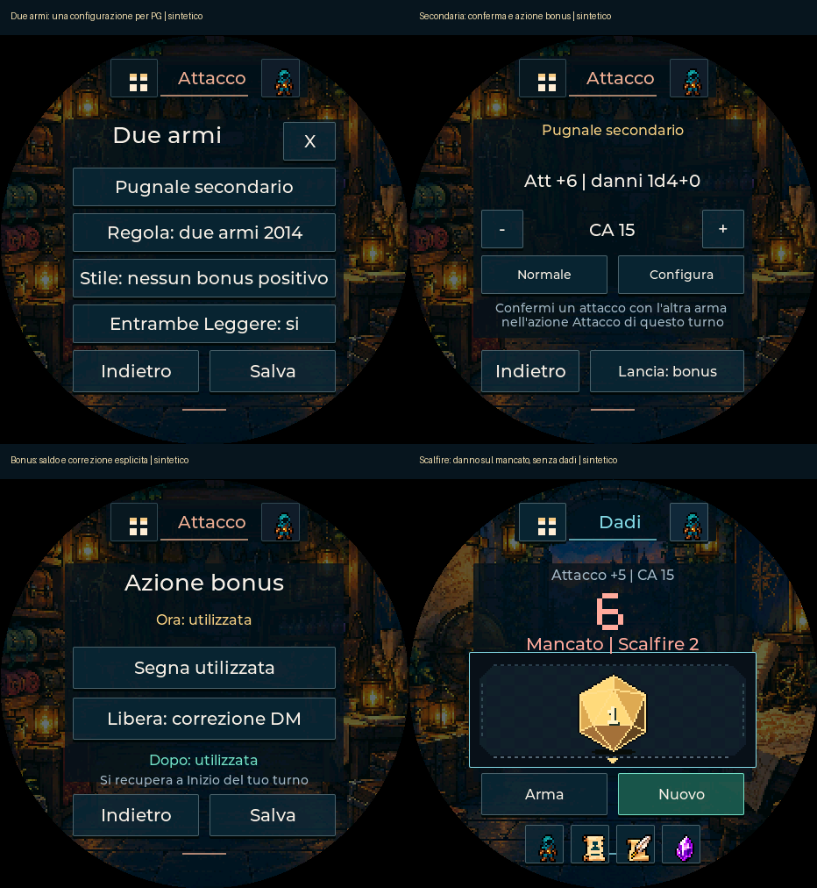

> v0.114: [Nick, Dual Wielder 2024, Cleave e maestrie assistite](ATTACCHI-EXTRA-MAESTRIE.md).
> Nuovi contatori per turno e formati PC v28 / USB25 / PDDi; riferimenti precedenti sotto.

# Due armi, azione bonus e Scalfire · v0.113

13 novembre 2026. Funzioni del dispositivo, per tutti i PG con proprietà
compatibili. PC ed estensione restano strumenti di installazione e configurazione.

## Una configurazione, poi Secondaria

1. Equipaggia la principale. **Attacca → Dettagli attacco → Due armi**.
2. Scegli la secondaria dallo zaino. Le armi devono essere **due voci separate**:
   una pila con quantità due non crea automaticamente due mani o due attacchi.
3. Scegli **2014** oppure **Light 2024**, conferma che entrambe siano Leggere e
   configura lo stile solo se possiedi la capacità che aggiunge la caratteristica
   ai danni. **Salva** conserva le scelte, senza tirare o spendere risorse.
4. Da Attacca, **Secondaria** apre direttamente il suo tiro. Prima di premere
   **Lancia: bonus**, confermi di avere effettuato un attacco con l’altra arma
   Leggera nell’**azione Attacco di questo turno**. Il software non può verificare
   le azioni dichiarate al tavolo. True Strike da solo non soddisfa questo requisito.

La principale resta equipaggiata; non viene sostituita dalla secondaria. La
secondaria ha dado, bonus, competenza, Finezza e critico propri. Senza lo stile,
il modificatore positivo ai danni viene escluso; quello negativo rimane. Ira e
altri bonus già rappresentati mantengono i propri requisiti. L’effetto su un
bersaglio di Hex/Marchio richiede la stessa conferma esplicita del normale attacco.

Con True Strike disponibile, il comando compatto **2a / Bonus** apre la stessa
secondaria; **Varianti** resta disponibile per le altre magie contestuali.

Il profilo 2014 richiede due armi da mischia; quello 2024 permette anche armi
a distanza Leggere configurate. Due mani, impugnatura versatile a due mani,
scudo equipaggiato, quantità zero, arma uguale alla principale e modalità Lancio
bloccano il colpo aggiuntivo. **Scudo >** apre l’anteprima per riporlo con la
variazione CA; nessun oggetto viene riposto automaticamente.

Per la secondaria a distanza, **Munizioni** apre direttamente la scelta della
pila, lasciando equipaggiata la principale. Il collegamento è salvato per arma. La scelta 2024 non verifica automaticamente
Loading, mani necessarie alla ricarica o capacità che ne cambiano i requisiti.
Bonus e una munizione, quando configurata, si salvano insieme al tiro, anche sul
mancato. Pila esaurita: nessun dado né spesa parziale. La modalità senza consumo
rimane una scelta esplicita; non deduce la compatibilità dal nome.

In **Impugnatura** sono disponibili anche i comandi separati **Leggera** e
**Finezza**. Le proprietà possono essere impostate dal PC in **Inventario e armi**;
il pulsante **Due armi / azione bonus** configura il profilo completo.

## Una sola azione bonus, conservata dopo riavvio

Il saldo è condiviso fra attacco della secondaria, attivazione di **Ira**, lancio dei profili riconosciuti
**Hex 2024**, **Hunter’s Mark 2024** e **Divine Smite 2024**. Una seconda spesa
viene rifiutata prima dei dadi e senza consumare slot, utilizzi o quantità.
I danni di un Hex/Marchio già concentrato non spendono un’altra azione bonus.

**Stato → Turni e reazione → Inizio turno → Conferma** recupera reazione e azione
bonus del proprio turno. Fine turno, round generico, tempo trascorso, turni
altrui e riposi non liberano questo indicatore. Non esiste un timer reale che
decide quando inizia il turno. Dal tiro secondario bloccato, **Turno** porta
direttamente alla gestione.

**Bonus: pronta/usata >** mostra il saldo e permette una correzione esplicita:
segna utilizzata oppure libera per decisione del DM, poi **Salva**. Annullare
conserva il valore precedente. Usa questo comando per altre azioni bonus i cui
profili non hanno ancora un costo automatico. Non è un controllo completo di
azioni, reazioni, componenti e limiti di lancio degli incantesimi.

Errore di salvataggio: **Riprova** conserva lo stesso d20 e la stessa proposta.
Durante l’attesa non si sostituisce il PG, non si cambia modalità e non si
spende di nuovo. Se fallisce lo storico, il costo già salvato resta speso;
si riprende il registro senza duplicare il tiro. L’Annulla della scheda conserva
il proprio significato: ripristina l’ultima modifica, senza cancellare lo storico.
Un risultato ancora solo in RAM non viene recuperato dopo perdita di alimentazione.

## Scalfire / Graze 2024

**Attacca → Dettagli attacco → Impugnatura → Maestria: Scalfire 2024 → Rivedi → Salva**.
Questa scelta dichiara che la maestria è disponibile per quell’arma. Non concede
automaticamente competenze, capacità di classe o proprietà dal nome dell’oggetto.

Sul mancato, compreso 1 naturale, il risultato e lo storico mostrano
**Scalfire N**, con il solo modificatore della caratteristica usata per
l’attacco, minimo zero. Non aggiungono bonus dell’arma, Ira, Hex, Marchio,
Punizione o altri dadi. True Strike usa la propria caratteristica di lancio.
Non vengono generati dadi fittizi o modificati i PF locali: il danno potenziale
e le difese del bersaglio si risolvono al tavolo. Un colpo riuscito continua
nel normale percorso dei danni e non somma Scalfire.

La maestria è configurabile manualmente sul Pocket e sul PC. L’import Beyond
riconosce ora **Light** solo da proprietà strutturate con ID positivo e nome
canonico, insieme a Finezza e impugnature già supportate. Nomi, descrizioni,
homebrew e dati ambigui non attivano nuove regole. Scalfire, stile e associazione
della secondaria richiedono configurazione esplicita: non sono dedotti dall’import.

## Aggiornamento e compatibilità

Aggiorna firmware, app PC e componente alla **0.113.0**, usando **Conserva dati**.
Il sito segnala anche un componente 0.112 che sa già aprire Beyond ma non gestisce
il nuovo protocollo. Nessun nuovo look SD, cambiamento delle partizioni o
reimportazione obbligatoria. PG, raccolta, tasti, Wi-Fi e accesso Beyond restano
conservati. Le nuove schermate mantengono la navigazione locale dei tasti fisici.

| Dato nuovo | Formato |
| --- | --- |
| Secondaria, saldo bonus, Light o Scalfire nel modello PC | PC v27 |
| Trasferimento dei nuovi dati | USB24, senza perdita silenziosa verso firmware precedenti |
| Stato nativo con questi dati | PDDh, massimo 77.505 byte |
| Diagnosi firmware | USB24 / capacità stato43 |
| Contenitore backup / indice SD | v1 / PDL1 invariati |

I formati precedenti restano leggibili. Un PG senza nuovi dati mantiene il
formato precedente pertinente; un vecchio backup non viene aggiornato o
modificato nel repository. Il saldo dell’azione bonus segue il backup nativo e
la copia SD. Eliminare o riconfigurare come oggetto la secondaria sul PC rimuove
il collegamento senza perdere il saldo già speso.

## Verifiche e lavoro rimanente

Suite JS, suite nativa generale e 171 viste di produzione; 3.200 combinazioni
indipendenti di caratteristiche/stile/Ira/scudo/bonus/Light, 180 casi Scalfire
con caratteristiche fisiche e di lancio, 110 confronti PC → USB24 → C → backup.
Metadati malformati, perdita dei dati per downgrade e alias impropri rifiutati.
Test LVGL di bozza, annullamento, conflitti, tasti, salvataggio fallito, d20
conservato, munizioni della secondaria, storico in attesa e ripresa dopo riavvio.
ASan/UBSan, compilazione ESP32-S3 e browser con risposte USB/account sintetiche.
Numeri della suite e margine flash nel [resoconto](STATO-SOFTWARE.md).

Restano **Nick**, Dual Wielder e altre eccezioni, le altre maestrie, Lancio della
secondaria, Loading/ricarica, munizioni speciali e recupero proiettili. Restano
inoltre altri profili magie, costi condizionali, bersagli e fusione dei progressi
Beyond/Pocket. Una descrizione consultabile non equivale a una regola automatica.

Nessuna nuova lettura reale Beyond, scrittura verso Beyond o modifica di raccolte
personali in questo rilascio. Le immagini e le prove nuove sono sintetiche;
autenticazione privata su ESP32, touch/USB/Wi-Fi e interruzioni fisiche restano
un collaudo separato. Nessuna credenziale o risposta completa di un PG pubblicata.
