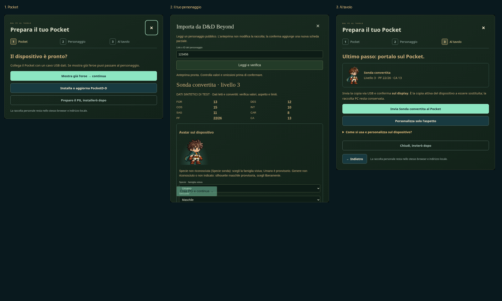

# Da zero al tuo eroe — PocketD-D v0.84

Per **aggiornare il firmware o installare i look sulla SD**, basta la pagina
web in Chrome/Edge con il Pocket collegato via USB: nessun pacchetto da
riscaricare. [GitHub Pages e attivazione iniziale](GITHUB-PAGES.md).

I passaggi seguenti servono per l’**importazione Beyond tramite connettore locale**.
Su **Windows x64**, usa Chrome o Edge e il pacchetto PC completo. Node.js e
firmware sono inclusi: non serve installare Node, Python, npm o compilare.

1. **Estrai tutto lo ZIP** e apri `Avvia-PocketDD.cmd`. Lascia aperta la finestra
   durante la preparazione. Si apre la guida nello stesso indirizzo locale
   della raccolta, `http://127.0.0.1:5173/?setup=1`.
2. **Segui Pocket → Personaggio → Al tavolo.** Se mostra già l’eroe salta il
   firmware. Altrimenti installa dalla guida, controlla il display e continua.
   Incolla il link Beyond pubblico, verifica i valori, scegli l’avatar e crea
   la nuova scheda. Le altre schede PC restano conservate.
3. **Invia via USB e conferma sul display.** Il salvataggio è riuscito soltanto
   quando il Pocket risponde che ha importato. Poi puoi scollegare il PC.

Tre passaggi descrivono il percorso, non tre clic totali: scelta della porta,
controllo del modello, consenso sui limiti e conferma sul display restano
espliciti. Non è necessario verificare la porta con un secondo comando prima
di inviare. Il firmware è solo per Waveshare ESP32-S3-Touch-AMOLED-1.75 standard,
**non C**. Gli aggiornamenti controllano le partizioni; nessuna cancellazione
completa della flash. Conserva un backup prima di sostituire il firmware o
una copia del personaggio con progressi importanti.

Puoi preparare il PG adesso e rimandare installazione/invio. La guida non
considera completata un’operazione saltata. La creazione Beyond usa anteprima,
accettazione dei limiti e un pulsante esplicito; nella guida non aggiunge un
ulteriore popup di conferma. HTTP e JSON validi non risolvono blocchi o regole
non convertite: i problemi restano visibili e la conferma viene disabilitata.

Prima dell’invio puoi aprire **Controlla dati e regole del PG**: mostra i valori
attuali e porta direttamente agli editor. Le omissioni Beyond restano
consultabili anche dopo una correzione locale. [Dettagli e prove](SESSIONE-V082.md).

Se la conversione è bloccata, i problemi compaiono subito sotto i valori e la
conferma viene sostituita da una spiegazione. [Correzione 0.82.1 e limiti delle
armi personalizzate](BEYOND-CONSENSO-V0821.md). Per aggiornare questa parte basta
il nuovo pacchetto PC: se il Pocket mostra già l’eroe, salta il firmware.

## Aspetto e uso

Nell’importazione scegli specie, silhouette e look della classe. In Al tavolo,
**Personalizza solo l’aspetto** apre l’editor estetico, senza esporre modifiche
alle statistiche. Le modifiche si applicano con Salva aspetto; Annulla conserva
la scheda. Dopo una modifica occorre inviare di nuovo la copia al dispositivo.

Sul Pocket: Arma e Magie dalla home; tocca i PF per Danni e Cura; swipe nelle
liste; pressione lunga sulle icone per l’aiuto. Tocca l’avatar per aspetto e
sfondi. Menu → ingranaggio → Tasti configura le scorciatoie: tocca il tasto e scegli direttamente la funzione. I look delle classi
usano la SD opzionale: con firmware 0.83 e scheda FAT32 nel Pocket, premi
**Installa look sulla SD via USB** nella guida/installer o nell’editor avatar.
Attendi la verifica finale e scegli Classe → Anteprima → Conferma sul Pocket.
[Procedura SD e limiti](SD-WEB-USB.md). Il gioco offline non richiede Wi-Fi,
ponte, account Beyond collegato o Foundry.

Wi-Fi opzionale: **Menu → ingranaggio → Wi-Fi → Cerca reti**. Scegli la rete,
inserisci la password sul Pocket, **Avanti → Collega** e attendi la conferma
di salvataggio. Non serve aprire l’hotspot. [Dettagli e limiti](WIFI.md).

## Se qualcosa non va

- Estrai lo ZIP prima di avviare; conserva anche `runtime`, `dist` e `scripts`.
- Per USB usa Chrome/Edge, cavo dati e una sola app che occupi la porta.
- Dopo il firmware attendi l’eroe; la porta può cambiare al riavvio.
- Un errore, un file scaricato o il solo controllo della porta non equivalgono
  a un PG salvato sul dispositivo. Non ritentare alla cieca: controlla il display
  e apri i dettagli USB nella schermata di invio.
- Se l’invio fallisce, dalla stessa finestra puoi usare **Leggi diagnosi firmware**
  e **Scarica report USB** (in Altre opzioni nella guida). Il report conserva le
  fasi e gli esiti, non il JSON del PG. La lettura diagnostica non invia la scheda.
- La raccolta è nel browser: usa lo stesso browser e indirizzo. Non cancellare
  i dati del sito e conserva i backup. Avviare due volte la stessa versione
  riutilizza il servizio già aperto; versioni diverse richiedono chiudere la
  vecchia finestra. Non viene terminato automaticamente alcun programma.

Il runtime ufficiale Node v24.22.2 non modificato, la licenza e le impronte
sono in `runtime/`. SHA256 e architettura PE x64 vengono verificati durante
il confezionamento. La shell Windows e l’eseguibile Windows non sono eseguiti
nell’ambiente Linux di sviluppo; i servizi e il pacchetto vengono verificati
con Node sull’host. macOS/Linux possono usare Node.js 24 di sistema e
`node --use-env-proxy scripts/start-pc.js`; il runtime incluso è Windows x64.

**Prove fisiche ancora aperte:** il precedente flash nero/ritorno a Elian non
è dichiarato risolto. La guida è verificata con browser, connettore e USB
sintetici: non sostituisce il collaudo del tuo hardware o del ponte autenticato.
La raccolta personale e il tuo account Beyond non vengono modificati dai test.

Il sito scarica blocchi verificati e li ricompone automaticamente in un unico
PocketDD-PC.zip. Nessun passaggio manuale: parte mancante o checksum errato
impediscono la creazione dello ZIP. Non usare vecchi link diretti al file.
