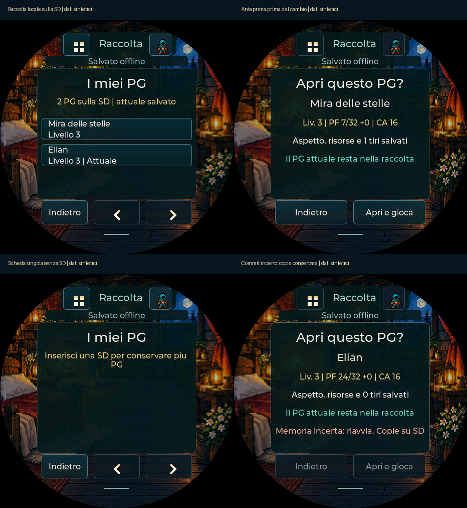

# I miei PG sul Pocket

31 ottobre 2026 · v0.90. Il Pocket può conservare fino a **32 copie locali sulla
SD**, scegliere un personaggio, vedere l'anteprima e aprirlo senza PC o rete.
PF, slot, usi, inventario, concentrazione, effetti, avatar, sfondo e storico
appartengono alla singola copia. Luminosità, attenuazione, animazione e tasti
rimangono preferenze del dispositivo.

Le immagini sono del firmware eseguito su PC. La nuova raccolta non è ancora
collaudata su SD fisica o durante una vera interruzione dell'alimentazione.
USB, installer e installazione degli asset SD sono già riferiti funzionanti;
questo non sostituisce il collaudo della nuova funzione.

## Uso in pochi passi

1. Dal [sito](https://shydanrem.github.io/PocketD-D/) aggiorna il firmware con
   l'opzione che conserva i dati, lasciando inserita la SD FAT32 già funzionante.
   Non serve reinstallare i look o mettere manualmente file del PG sulla SD.
2. **Menu → icona della scheda in alto a sinistra**, con nome «I miei PG» alla
   pressione prolungata. Aprendo la raccolta salvi anche la copia attuale.
3. Tocca un nome → controlla PF/CA, risorse/aspetto e storico → **Apri e gioca**.
   La scheda che stavi usando resta nella raccolta. Il PG già attuale si apre
   direttamente, senza una conferma o una scrittura NVS aggiuntiva.

Prima delle successive importazioni USB confermate e dei ripristini USB, il
Pocket salva la scheda uscente nella raccolta se la SD è montata. Il nuovo PG
diventa una copia locale all'apertura della raccolta o prima del successivo
cambio/import. Le importazioni restano nuove copie: non si uniscono PG solo
perché hanno lo stesso nome. I personaggi sostituiti prima di questo aggiornamento
non ricompaiono automaticamente; restano recuperabili dalle copie PC già esistenti.

Senza SD continua il percorso precedente con un PG attivo e backup USB. Con una
SD montata ma non scrivibile, o a raccolta piena, il cambio viene fermato prima
di sostituire il PG attuale. Il display spiega il problema; non cancellare dati
per riprovare. Questa prima versione non ha ancora eliminazione/rinomina delle
copie dal dispositivo né esportazione USB dell'intera raccolta.

Tasti nel percorso: PWR breve entra/sposta il fuoco, BOOT breve seleziona il
comando evidenziato, BOOT lungo torna indietro. Al primo BOOT si mostra il fuoco,
senza confermare alla cieca. PWR lungo resta riservato all'alimentazione. Le
associazioni globali configurate vengono conservate e riprendono fuori dal percorso.

## Cosa significa rispetto a Beyond

**Questa è una raccolta locale, non ancora importazione Wi-Fi da Beyond.**
L'elenco dell'account nell'estensione è stato provato dall'utente e confermato
completo il 31 ottobre. Quel risultato non trasferisce ancora schede o sessioni
al dispositivo. Per aggiungere adesso un PG Beyond si usa il percorso PC/USB
già funzionante, poi si cambia PG dalla raccolta senza PC.

Restano conversione nativa del JSON Beyond, associazione protetta, rinnovo della
sessione e lettura delle schede autenticata sul Pocket. Nessuna scrittura nuova
verso Beyond. Se è configurato il ponte sperimentale, il cambio di identità
ferma l'invio del nuovo PG finché il ponte non viene riabbinato esplicitamente.

## Conservazione e recupero

- Dati in `pocketdd/characters/pg01a.pdl` / `pg01b.pdl`, fino alla coppia 32.
  Ogni file è un contenitore PDL1 con identità d'installazione, revisione,
  backup nativo completo e CRC32. Non è JSON Beyond né un pacchetto USB ridotto.
- Si scrive la copia inattiva, si eseguono flush/sync, chiusura e rilettura
  integrale. Una scrittura incompleta non sostituisce la copia valida precedente.
  Una versione futura valida viene conservata, senza tentare una conversione ridotta.
- Prima di aprire un altro PG si salva quello attuale; si prepara il suo storico
  NVS e si salva la destinazione SD con la nuova identità, poi si commette la
  nuova scheda NVS. Non c'è un puntatore attivo separato che possa indicare il
  personaggio sbagliato dopo un riavvio.
- Una piccola identità casuale **non segreta** è salvata/verificata in NVS prima
  dei checkpoint SD. Cambia dopo un azzeramento NVS: un'altra installazione non
  sovrascrive una copia solo perché epoca e nome coincidono. Non è una credenziale
  Beyond e non viene aggiunta alle schede o ai backup USB.
- La copia selezionata viene riletta prima del cambio: se è cambiata dall'anteprima
  si chiede di riaprirla. Un commit NVS dall'esito incerto blocca nuovi tentativi
  fino al riavvio; entrambi gli storici e le copie SD rimangono disponibili.

Durante il gioco il salvataggio attivo resta quello NVS esistente. I checkpoint
SD avvengono all'apertura della raccolta e prima di cambio/import/ripristino;
non sono un mirror continuo a ogni PF speso. A dispositivo spento, copiare tutta
la cartella `pocketdd/characters` permette di conservarla fuori dalla SD. I file
contengono dati personali del PG: non allegarli a issue pubbliche.

Due file e CRC proteggono i record da scritture interrotte/corruzione rilevabile;
non dimostrano da soli la tenuta dell'intero filesystem FAT durante un blackout.
Non estrarre o scambiare la SD durante salvataggi e cambi di personaggio.

## Verifiche software e prova sul dispositivo

339 test JS e suite nativa superati, 142 viste LVGL esercitate. Compilazione
ESP32-S3 riuscita; nuovo engine e interfaccia verificati anche con ASan/UBSan
(senza LeakSanitizer, non supportato nel sandbox).

Verificati: roundtrip nativo con 120 poteri, slot ordinari/patto, concentrazione,
effetti e 20 tiri; due PG omonimi, spostamento tra installazioni, capacità piena,
scrittura corta e sync fallito, recupero CRC e conservazione di versioni future.
Identità NVS: prima creazione, riavvio senza nuova entropia, reset e commit incerto.
UI reale LVGL: anteprima/annullamento, copia cambiata, preferenze del dispositivo,
progressi separati, conservazione prima di import USB, tasti locali e blocco
dopo commit incerto. NVS/periferiche simulate; filesystem reale del PC.

Per il collaudo fisico: aggiorna conservando i dati, apri «I miei PG» sul PG già
presente, importa una seconda copia via USB, apri la raccolta e passa fra le due.
Modifica un saldo su ciascuna, cambia PG e riavvia: ogni copia deve ritrovare il
proprio saldo, aspetto e storico. Verifica anche la fluidità. Prima della prova,
acquisisci il normale backup USB del PG con progressi importanti.
