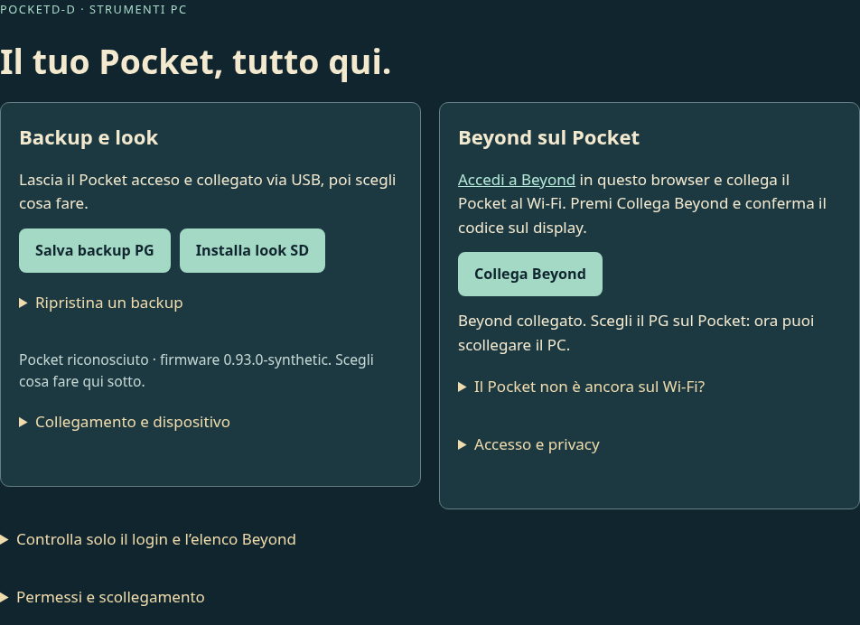

# Pocket PC: scegli cosa fare, il collegamento è automatico

**Firmware v0.94:** dopo l’associazione, [connessione e ripresa della richiesta
Beyond](AUTONOMIA-RECUPERO.md) avvengono sul Pocket. La pagina e l’estensione 0.93
restano compatibili; aggiornare il firmware conserva PG, tasti e SD.

2 novembre 2026 · v0.93. Una pagina per **Beyond, look SD e backup**. La porta
riconosciuta viene riutilizzata per le operazioni successive nella stessa pagina:
nessuna verifica USB separata obbligatoria e nessuna preparazione manuale dell’accesso.

## Da dove partire

Apri il [sito PocketD-D](https://shydanrem.github.io/PocketD-D/) e premi **Collega
Pocket / Apri Pocket PC**. Se il componente è già caricato, si apre la sua pagina.
Il sito può solo rilevarne la presenza e aprire quella pagina: non riceve cookie,
credenziali, dati del PG o messaggi USB.

La prima volta il sito mostra come aggiungere il piccolo componente a Chrome/Edge:
scarica lo ZIP, estrailo, apri `chrome://extensions` o `edge://extensions`, abilita
Modalità sviluppatore e carica la cartella `extension`. Poi premi **Ho aggiunto
Pocket · continua** sul sito. Se è già installato, sostituisci i file e ricaricalo.
Chrome non permette a una pagina di installare automaticamente un’estensione
non pubblicata nel suo store: questi passaggi iniziali non sono eliminabili.

Per il firmware usa **Installa / aggiorna** sul sito. La revisione fisica della
scheda va ancora confermata: il chip ESP32-S3 da solo non identifica la variante.
Il pacchetto Windows completo resta facoltativo per la configurazione avanzata.
Il sito scarica firmware, look o archivio PC solo quando apri lo strumento relativo.

## Beyond: un pulsante dopo il primo consenso

1. Accedi a Beyond nello stesso browser e collega il Pocket al Wi-Fi.
2. In Pocket PC premi **Collega Beyond**. Solo la prima volta compare prima
   **Consenti accesso a Beyond**: autorizza i permessi, poi collega.
3. Scegli la porta se non è già stata riconosciuta nella pagina. L’accesso viene
   verificato automaticamente; confronta il codice e conferma **sul Pocket**.
   Scegli lì se ricordare l’accesso in memoria non cifrata.
4. Attendi **Beyond collegato**: è la ricevuta del dispositivo dopo verifica e
   salvataggio, non il semplice completamento dell’invio USB. Poi scegli/importa
   il PG dal display e puoi scollegare il PC.

Non serve prima premere Controlla collegamento, Verifica accesso o preparare
l’account con un altro pulsante. Il controllo dettagliato dell’elenco è ancora
disponibile in un pannello facoltativo. Sessione scaduta, rete o formato inatteso
restano errori distinti; nessun fallback anonimo e nessun invio ripetuto del segreto.
La gestione delle credenziali e i limiti sono nella [guida Beyond](COLLEGAMENTO-BEYOND.md).

## Look e backup, senza permessi Beyond

- **Installa look SD:** lascia la microSD FAT32 nel Pocket e premi il pulsante.
  Se serve viene riconosciuto il dispositivo, poi il pacchetto pubblico viene
  scaricato, verificato e installato. Se è già presente e valido si evita la
  riscrittura. PG e altri file della SD restano conservati.
- **Salva backup PG:** premi il pulsante e conferma l’invio sul display. Il browser
  verifica il contenitore e scarica il file JSON sul tuo PC. Non lo carica su un
  server e non lo aggiunge ai pacchetti pubblici.
- **Ripristina un backup:** dopo un collegamento riconosciuto, scegli il file nel
  pannello dedicato. Il formato viene verificato prima del trasferimento; controlla
  l’anteprima e conferma sul dispositivo prima di sostituire la scheda attiva.
  In assenza di un collegamento usa **Collegamento e dispositivo → Controlla
  collegamento**, poi scegli il file.

Durante un’operazione le altre sono bloccate e compare **Interrompi**. Dopo un
annullamento o una perdita della conferma controlla il display prima di ripetere
un’azione che potrebbe essere già stata salvata.

## Quando cambia il collegamento

La selezione resta solo in RAM nella pagina, non in uno storage o in un servizio
che tiene occupata la porta. Ogni operazione riapre la porta e verifica il
protocollo prima di inviare dati; poi la chiude. **Cambia Pocket** apre nuovamente
la scelta esplicita. Uno scollegamento o un errore di trasporto invalida la
selezione; non si prova automaticamente un altro dispositivo.

Dopo aver chiuso/ricaricato la pagina o passando a un’altra origine del browser
può servire scegliere la porta di nuovo. Non si scansionano tutte le porte
all’avvio. La selezione del browser e le conferme sul dispositivo rimangono
intenzionali; evitare click ripetuti non significa saltarle.

## Compatibilità e prove

Le operazioni Beyond richiedono firmware **0.92 o successivo**; se la diagnosi
rileva una versione precedente viene indicato l’aggiornamento. I look richiedono
0.83. La v0.93 firmware cambia la versione, senza modificare logica nativa,
partizioni o formati: per la nuova interfaccia basta aggiornare il componente
PC se sul Pocket è già presente la 0.92.

**354 test JavaScript superati**, compilazione ESP32-S3 e controlli browser.
Test automatici: riuso della porta, esclusione reciproca fra strumenti, cambio
esplicito, scollegamento, controllo versione e protocollo, preparazione account
automatica e consenso. Nella pagina reale in Chromium sono stati eseguiti SD,
Beyond e backup con **un solo selettore**, più cambio dispositivo e rifiuto di
backup malformato. Permessi/cookie/seriale/servizi remoti erano simulati: non è
una nuova prova MV3 caricata né un accesso Beyond autenticato dall’ESP32.

USB/installer/asset SD di base erano già riferiti funzionanti dall’utente.
Il nuovo flusso PC e il percorso autenticato diretto richiedono ancora collaudo
reale su browser e hardware. Nessuna raccolta personale o credenziale reale è
stata usata o modificata da questi test.
