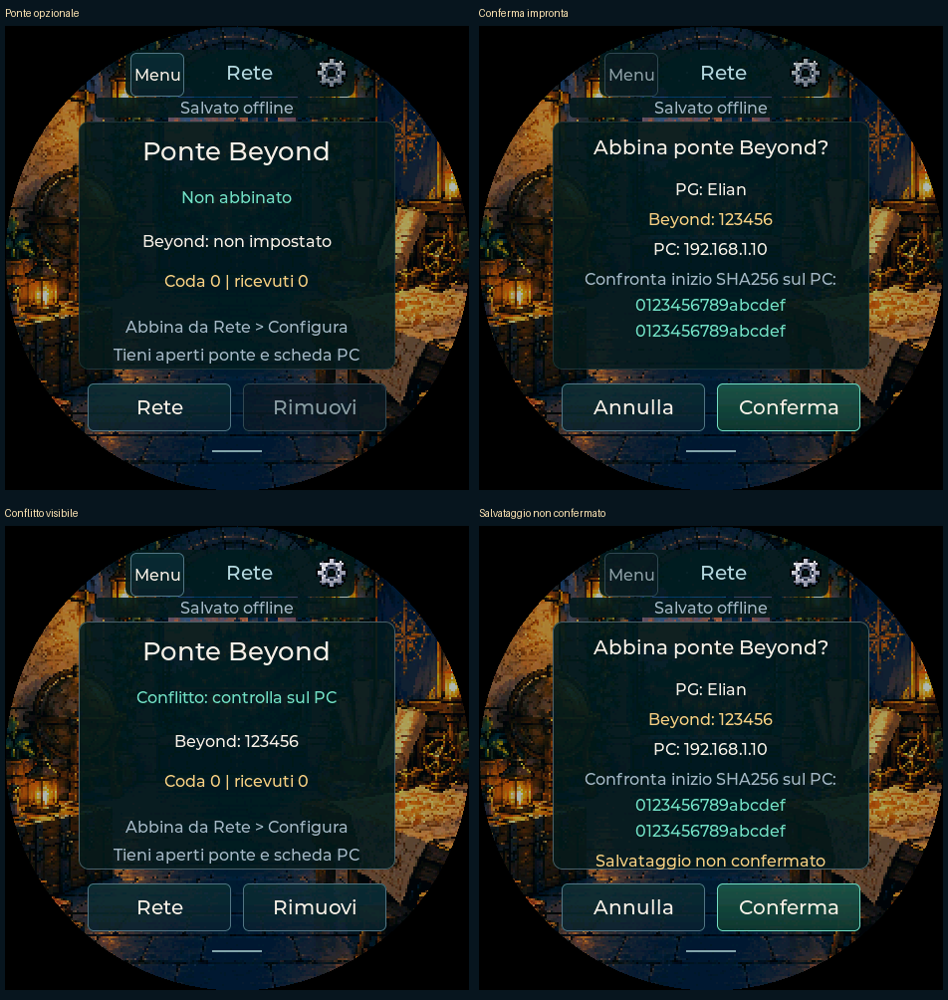

> Dalla v0.81 il pacchetto Windows x64 include Node.js. Avvia-Ponte.cmd
> usa il runtime incluso; non serve installarlo separatamente. Il ponte rimane
> opzionale e sperimentale. Per il primo utilizzo segui [Inizia qui](INIZIA-QUI.md).

# Ponte Beyond sperimentale — v0.79

Prima implementazione del percorso Pocket → Wi-Fi → PC → pagina Beyond. Non
richiede Foundry o Beyond20. Il login Beyond resta nel tuo browser. La raccolta
PC non viene aperta o modificata dal ponte e nessuna credenziale viene inclusa
nel backup del PG. La scheda funziona offline anche senza il ponte.

**Stato della verifica:** compilazione e prove software con SDK, pagine e dati
sintetici. Nessun tiro o aggiornamento PF è stato inviato al tuo account Beyond.
Ricezione dal broker e controlli dei campi della pagina sono adattatori interni:
serve ancora la prova con una tua pagina autenticata e il dispositivo reale.
Il browser dell’ambiente di sviluppo vieta per policy amministrativa le
estensioni non pacchettizzate: il test MV3 installato è bloccato. Il worker è
verificato con API Chrome simulate; UI e adattatore della pagina in Chromium
con origine e dati sintetici. Non è una prova dell’estensione sulla tua sessione.
Questa release non dichiara conclusa la sincronizzazione di produzione.

## Preparazione su Windows

1. Aggiorna app e firmware alla v0.79. Estrai tutto il pacchetto PC; Node.js 24
   rimane necessario. Conserva un backup del PG. Il problema USB precedente
   resta da collaudare: il ponte non prova che sia risolto.
2. Collega PC e Pocket alla stessa rete privata. Il Wi-Fi del Pocket si configura
   da **Menu → ingranaggio → Wi-Fi → Cerca reti**, con password sul display.
   **Configura da telefono / PC** conserva il portale come alternativa.
3. Avvia **Avvia-Ponte.cmd**. Si apre **http://127.0.0.1:8787/**. Lascia aperta
   la finestra. Se Windows chiede l’accesso di rete, usa la rete privata del PC.
   Il servizio del dispositivo usa HTTPS sulla porta **8788**, sul solo IPv4
   privato selezionato. Non occorre aprire porte sul router.
4. Se il PC ha più reti, puoi scegliere l’indirizzo con
   `node --use-env-proxy scripts/start-bridge.js 192.168.1.10`.
   Cambiare indirizzo richiede un nuovo abbinamento e certificato.
5. In Chrome/Edge apri la gestione estensioni, attiva Modalità sviluppatore e
   carica la cartella **extension** come estensione non pacchettizzata.
6. Dal ponte genera il codice di nove cifre; inseriscilo nel popup PocketD-D
   dell’estensione. Il codice è monouso, dura due minuti e accetta cinque tentativi.
7. Apri la tua scheda Beyond e la **gestione PF**. La prima versione riconosce
   campi standard in inglese; se il layout non è riconosciuto si ferma, senza
   cercare pulsanti o indovinare valori. Non usare due estensioni che alterano
   contemporaneamente i tiri del broker.

## Abbinamento del dispositivo

1. Nel ponte inserisci il link o ID del PG e scegli registro personale oppure
   campagna della pagina aperta. Crea l’abbinamento e copia la configurazione.
2. Sul Pocket apri **Wi-Fi → Configura da telefono / PC**. Collega temporaneamente PC o
   telefono alla rete PocketDD indicata sul display, poi apri **http://192.168.4.1**.
3. Nella sezione **Collega il ponte Beyond** incolla la configurazione.
   Sul Pocket compare un’anteprima con nome locale, ID Beyond, IP del PC e
   inizio dell’impronta SHA256. Confronta **tutte le prime 32 cifre** con quelle
   del ponte PC e conferma. Se il salvataggio fallisce non viene confermato il nuovo collegamento e la configurazione in memoria resta precedente: controlla lo stato prima di riavviare. Una scrittura NVS interrotta richiede verifica sul dispositivo.
4. Torna alla rete abituale del PC. Pocket deve essere collegato a quella rete;
   il portale temporaneo scade e si chiude normalmente.
5. Nel ponte controlla PG e PF sui due lati. PF attuali, massimi e temporanei
   devono coincidere. Premi **Avvia / riprendi dopo verifica**. I tiri precedenti a questa
   verifica non vengono pubblicati. Un riavvio del Pocket richiede una nuova
   verifica dal PC; importare/ripristinare un PG blocca il vecchio abbinamento.

La configurazione contiene una chiave del collegamento locale: non pubblicarla,
non inserirla in un issue e non condividerla. Certificato e chiavi sono creati
localmente all’avvio: nessuna chiave è distribuita nei pacchetti.
La chiave Pocket è in `pdd_nvs/pdd_sync`; sul PC i dati privati sono in
`%LOCALAPPDATA%/PocketDD/bridge` (Linux/macOS: cartella utente `.local/share`).
La flash non è cifrata. Il certificato del singolo ponte è usato come autorità
fidata, con controllo dell’indirizzo IP; non viene disabilitata la verifica TLS.
L’orologio iniziale viene portato almeno all’ora inclusa nella configurazione
prodotta dal PC. È necessario che l’orologio del PC sia corretto.

## Tiri e PF

- **Tiri:** il risultato nasce e si salva sul Pocket, poi viene trasformato in
  un evento del registro Beyond mantenendo facce, bonus, modalità e totale.
  Non viene cliccata la barra dadi del sito e non viene generato un altro tiro.
  L’animazione rimane sul Pocket. L’animazione 3D Beyond non è implementata.
- **Osservato:** è stato ricevuto un evento corrispondente dal broker della
  pagina. Non equivale a verifica della persistenza del registro dopo reload;
  quest’ultima rimane da provare nella sessione autenticata.
- **PF:** si confrontano prima i valori della pagina con lo stato atteso;
  i campi PF attuali/temporanei supportati vengono aggiornati tramite la pagina.
  **Verificato** richiede poi una rilettura concordante dal character-service
  pubblico, usando il connettore PocketD-D. Un cambiamento del solo DOM o un
  HTTP 200 non bastano. Questo percorso richiede un PG pubblico convertibile.
- **PF massimi:** controllati ma non modificati dal ponte; cambiamenti del
  massimo e layout diversi restano non supportati. Condizioni, inventario,
  utilizzi, slot e statistiche non vengono sincronizzati.
- **Direzione:** Pocket → Beyond. Modifiche esterne su Beyond producono un
  conflitto, senza sovrascrittura automatica o applicazione inversa sul Pocket.
  La serializzazione locale non offre un confronto/scrittura atomico sul server
  Beyond: altre finestre possono ancora modificare la scheda durante l’operazione.

## Disconnessioni, incertezze e limiti

La coda del ponte è persistente, con massimo **256** eventi. Identità degli
stessi tiri stabili e singola assegnazione a una pagina impediscono reinvii
automatici. Un tentativo ricevuto non viene rieseguito dopo perdita dell’ACK;
si può ritrasmettere soltanto la ricevuta. Se non si sa cosa sia accaduto,
compare **Incerto** e si fermano gli invii successivi per quel PG.

Il Pocket conserva gli ultimi **20 tiri** nel proprio storico. Se il ponte non
li riceve prima che siano superati, segnala il buco: non inventa i tiri mancanti.
Le variazioni PF sono osservazioni dello stato salvato, non un diario di ogni
pressione: variazioni ravvicinate possono essere accorpate nello stato finale.
Il gioco locale e i salvataggi non dipendono dalla rete.

Controlla prima Beyond in caso di Incerto/Conflitto. Correggi manualmente i PF
per far coincidere i due lati, quindi **Ho verificato: riconcilia senza reinviare**
e riavvia dopo verifica. La riconciliazione marca esplicitamente gli eventi
non conclusi come manuali: non li ritira o ripubblica. Un invio ancora in corso
va prima concluso o dichiarato incerto. Archivia solo gli eventi conclusi.

**Pausa** sul PC ferma nuove assegnazioni, mantenendo in coda i nuovi eventi ricevuti. Per riprendere si confronta Beyond con l’ultimo stato remoto verificato, prima degli eventi in attesa. Un’operazione già consegnata non si
può annullare retroattivamente. La sospensione del Pocket attende la conclusione
della richiesta HTTPS e poi arresta la radio; il PC può concludere eventi già
ricevuti. **Rimuovi** sul dispositivo cancella solo la chiave locale: per
interrompere il ponte revoca anche l’abbinamento sul PC. Dopo dieci secondi
senza heartbeat il ponte non assegna altri eventi.

Sono ancora da misurare sul dispositivo latenza, memoria, fluidità, batteria,
riconnessione e affidabilità della LAN. Nessuna di queste prove è sostituita
dai test sintetici. Nessun cookie, password Beyond o JSON sorgente completo
viene richiesto o trasmesso al Pocket.

[Report delle prove e controlli ancora aperti](PONTE-BEYOND-PROVE.md).

Catture del software nativo su PC: non fotografie né collaudo della radio.
