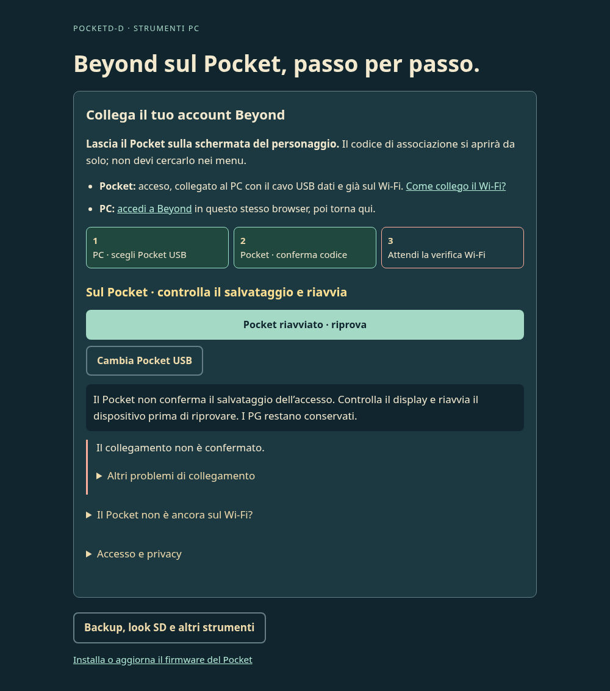
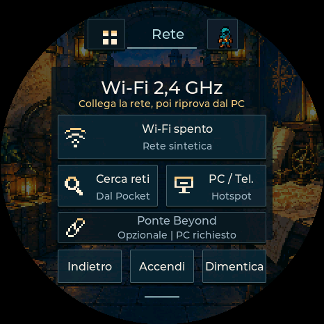

# Revisione software e percorsi d’uso · v0.116

16 novembre 2026. Priorità: Pocket utilizzabile sul dispositivo, primo collegamento
Beyond dal PC più semplice, errori recuperabili e protezione dei PG esistenti.
La revisione riguarda percorsi e regressioni riproducibili; non certifica tutte
le regole D&D o le periferiche senza un collaudo fisico.

## Problemi trovati e corretti

| Problema osservato nel codice / riprodotto nei test | Comportamento corretto |
| --- | --- |
| Backup e look riapriva la scheda Beyond esistente senza cambiare vista: gli strumenti potevano restare nascosti | La scheda resta unica ma passa alla vista richiesta, anche con richieste concorrenti e ritorni Beyond → strumenti → Beyond |
| Dopo aver caricato l’estensione bisognava ritrovare il sito e il comando iniziale | Alla sola prima installazione si apre la pagina di benvenuto Beyond; nessun accesso o USB automatico, nessuna nuova scheda a ogni aggiornamento |
| Continua dopo l’installazione apriva sempre Beyond, anche se si proveniva da Backup e look | Conservata la scelta corrente anche dopo il ricaricamento necessario a rilevare l’estensione: account oppure strumenti |
| Il PC chiedeva di confrontare un codice prima di averlo effettivamente ricevuto | Scelta USB, verifica login, apertura codice, conferma sul Pocket e verifica Wi-Fi sono fasi distinte |
| Mancava un cambio porta nel percorso Beyond; una porta già ricordata obbligava ad aprire gli strumenti avanzati | Cambia Pocket USB dimentica la scelta precedente senza modificare il dispositivo; la scelta successiva resta esplicita |
| Il Pocket senza Wi-Fi mostrava Collega disabilitato; un calo di rete poteva lasciare il bottone visualmente obsoleto | Mostra Wi-Fi, aggiorna il pulsante al cambio rete e ricontrolla la connessione prima di approvare |
| Gli errori nativi venivano ridotti a FAILED senza motivo | Dodici motivi fissi e privi di dati personali: rete, Wi-Fi, orologio, login, identità, elenco, memoria, salvataggio, tempo, dispositivo occupato, limite richieste e formato |
| Il PC non distingueva l’azione utile per recuperare | Istruzione e pulsante coerenti con l’errore; link diretto a login o aggiornamenti dove pertinente |
| Controlla/Cancella risultato dei diagnostici interrompevano implicitamente l’associazione | I diagnostici non cancellano l’associazione; i comandi incompatibili sono disabilitati durante il trasferimento USB |
| Ripetere il challenge poteva riavviare ogni volta l’attesa PC di due minuti | Scadenza unica della conferma e tempi limitati anche in presenza di messaggi ripetuti |
| Messaggi d’avvio ripetuti davano solo un generico errore USB | Avviso di possibile riavvio con indicazione su alimentazione, cavo e schermata da attendere |
| Dopo il successo mancava un ingresso diretto per un secondo dispositivo | Collega un altro Pocket riapre la scelta USB senza scollegare l’account già salvato nel primo |

Il controllo del pacchetto completo ha rilevato anche immagini mancanti delle
guide recenti. Ora report e immagini sono inclusi, con verifica dei byte nello
ZIP. Il pacchetto prende i file di estensione, ponte e sorgenti dai percorsi
versionati: i file temporanei non vengono distribuiti. Una prova aggiunge tre
file sintetici non versionati e verifica che restino esclusi dall’archivio.

## Percorsi rivisti

- **Installazione/aggiornamento:** download e regioni firmware verificati, partizioni
  controllate, aggiornamento conservativo predefinito, porta rilasciata a fine
  operazione. Non richiede il pacchetto PC completo.
- **Prima associazione:** guida dal sito, estensione, consenso, scelta USB,
  confronto e approvazione fisica, ricezione dell’accesso e verifica autonoma.
  Il percorso di recupero non ripete automaticamente un invio di credenziali.
- **Importazione:** account/elenco distinti da lettura, formato e conversione;
  anteprima prima di importare, blocchi distinti dai limiti, verifica copie locali
  e checkpoint della scheda uscente su SD. Non si fonde il progresso Beyond/Pocket.
- **Backup e look SD:** operazioni esplicite, scelta porta condivisa, esclusione
  reciproca con associazione, ripristino con verifica/anteprima/conferma separata.
- **Uso sul dispositivo:** navigazione e tasti, equipaggiamento/preparazione,
  tiri e costi, PF/danni, concentrazione, recuperi e salvataggi coperti dalla suite
  nativa. Le regole assistite sugli avversari restano assistite, non automatiche.

## Compatibilità e limiti

Aggiorna l’estensione alla **0.116**. Per il pulsante Wi-Fi durante il codice e
per i motivi di errore precisi aggiorna anche il firmware a **0.116**, scegliendo
**Aggiorna PocketD-D**. Il componente nuovo continua a funzionare con firmware
0.92–0.115: i vecchi errori generici restano generici. Le ricevute di successo
non cambiano. USB25/PDD44, copie PG, tasti, impostazioni, SD e partizioni invariati.

Il Wi-Fi dal codice chiude il vecchio tentativo prima di aprire le reti.
Dopo aver collegato la rete si riprova dal PC, generando un nuovo codice:
nessuna approvazione precedente viene riutilizzata e nessun cookie parte prima
della nuova conferma fisica. Il browser non dichiara un successo sul solo HTTP. Il sito conserva in sessionStorage
solo l’intento temporaneo tools/beyond per continuare una volta dopo il ricaricamento,
mai account, porta USB o credenziali.
Accesso ricordato opzionale in memoria attualmente non cifrata, separato dai PG;
nessun cookie o token sul sito, nell’estensione, sulla SD o nei backup PG.

## Verifiche e lavoro ancora aperto

**393 test JS** passati, suite nativa completa, **173/173 viste LVGL** anche con
ASan/UBSan e build ESP32-S3 (0x3de090 byte, circa 136 KiB liberi).
Test JS con risposte controllate, UI HTML/JS reale in Chromium con API Chrome,
HTTP e USB simulati, suite C e viste LVGL con servizi simulati, controlli memoria
e compilazione ESP32-S3. Test di mancato login, cambio porta, annullamento,
conferma, errori prima/dopo l’invio e attesa della ricevuta finale. Le prove
software non equivalgono a un nuovo login reale ESP32 o a un trasferimento fisico.

L’utente ha confermato in precedenza USB/installer/SD e l’elenco completo
nell’estensione. **L’associazione reale, il rinnovo dopo riavvio e i PG privati
sul Pocket restano da confermare.** Restano inoltre prove di batteria, fluidità,
interruzioni di alimentazione e compatibilità di rete. Nessuna nuova lettura
privata reale o scrittura Beyond è stata eseguita in questa revisione.
