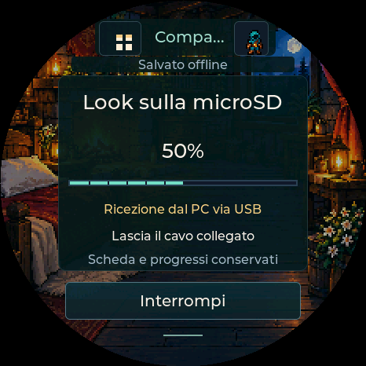

# Look sulla SD dal browser — v0.83

La SD resta nel Pocket. Chrome/Edge su PC scarica il catalogo, lo verifica e lo
trasferisce via USB; non occorrono lettore SD, Python o copia manuale di cartelle.
Sono inclusi **504 look**: 21 famiglie visive × 2 silhouette × 12 classi.
Sfondi e avatar originali rimangono incorporati nel firmware.

## Procedura

1. Aggiorna una volta al **firmware 0.83**, scegliendo **Aggiorna / conserva dati**
   nell’installer. Non scegliere cancella memoria. Attendi il personaggio sul display.
2. Con dispositivo spento, inserisci una microSD già FAT32. Riaccendi e collega
   il cavo USB dati. Chiudi gli altri programmi che occupano la porta.
3. Nella pagina installer oppure nell’app PC, premi **Installa look sulla SD**;
   scegli la porta del Pocket avviato. Il comando è disponibile anche nell’editor
   avatar e nel passo Al tavolo della guida.
4. Attendi **Look verificati sulla SD**. Il 100% indica la ricezione, poi il
   Pocket rilegge e verifica il catalogo: fino alla conferma finale non è concluso.
5. Se usavi Originale, il Pocket apre direttamente la scelta **Classe**:
   scegli il look, **Anteprima → Conferma**. Installare il catalogo non cambia
   automaticamente l’aspetto salvato, le statistiche o l’equipaggiamento.

Per un PG multiclasse la classe estetica rimane una scelta personale. Specie e
silhouette sono quelle del PG importato o scelte manualmente. Le armi speciali
importate come oggetti richiedono ancora configurazione: questo aggiornamento
installa grafica e non converte nuove regole Beyond.

## Errori e interruzioni

- Firmware precedente: viene richiesto l’aggiornamento prima di inviare dati.
- SD assente, non montabile o spazio insufficiente: errore esplicito; nessuna
  formattazione automatica, nessuna cancellazione del PG o di altri file.
- Annulla/disconnessione: il file temporaneo viene eliminato all’annullamento o
  dopo 45 secondi senza comandi; si riparte dall’inizio. Non scollegare durante
  la verifica finale; controllare il display se l’esito USB non è confermato.
- Il catalogo precedente valido viene conservato come `classes.bak`; il caricatore
  lo usa se `classes.pdc` manca o è invalido. Non è una garanzia contro ogni danno
  fisico o corruzione FAT causata da una perdita di alimentazione.
- Il pacchetto manuale `PocketDD-SD.zip` rimane un’alternativa: estrarre `pocketdd`
  nella radice della SD FAT32 con un lettore PC.

## Riferimento TamaPoke e implementazione

Esaminato il repository pubblico originale [socquique/TamaPoke](https://github.com/socquique/TamaPoke/tree/1fff020c158282a384cc9b9357ada111e3eddba8),
commit `1fff020c158282a384cc9b9357ada111e3eddba8`, in particolare
[web/index.html](https://github.com/socquique/TamaPoke/blob/1fff020c158282a384cc9b9357ada111e3eddba8/web/index.html),
[sdmon.cpp](https://github.com/socquique/TamaPoke/blob/1fff020c158282a384cc9b9357ada111e3eddba8/sdmon.cpp)
e `tools/send_sd.py`. Il riferimento è il flusso web → WebSerial → SD con blocchi
2048 byte e riscontro per blocco. Il codice PocketD-D è scritto separatamente;
non sono stati copiati codice, sprite, nomi o pacchetti Pokémon. Il formato e il
protocollo PocketD-D restano distinti. La formattazione automatica di TamaPoke
non viene ripresa: PocketD-D conserva i file personali.

Protocollo asset v1, separato da USB17 del PG: `ASSET HELLO`, `BEGIN`, `WRITE`,
`FINISH`, `ABORT`, con prefisso `PDD`. Percorso fisso
`/sdcard/pocketdd/classes.pdc`, 6.195.200 byte. Payload esadecimale, offset
sequenziale e CRC32 per blocco, SHA256 dell’intero file, verifica di header,
tabella e tutti i 504 frame. `DONE` viene inviato solo dopo la rilettura finale.
Il browser verifica dimensione/SHA256 prima di aprire la porta e usa lo stesso
blocco esclusivo di importazione, backup e diagnosi. Il dispositivo scrive nel
task UI; il task USB inoltra una sola richiesta limitata alla volta.

File temporaneo `classes.new`, precedente `classes.bak`: nessun percorso
arbitrario, nessuna scrittura NVS, nessuna modifica di PG o partizioni. Catalogo
già identico: verifica completa e conclusione senza ricopiare. Il catalogo
installato non viene dichiarato sicuro solo perché un blocco è arrivato.

## Verifiche e limiti

Cattura sintetica del renderer reale; non è una foto del dispositivo.

Firmware ESP32-S3 compilato con ESP-IDF 5.5.5. Test host sul catalogo reale:
trasferimento completo, SHA/CRC, file esistente, spazio esaurito, annullamento,
scrittura corta, errore fsync, rinomina interrotta e recupero dal backup, file
estranei conservati. Parser rigoroso e stato del PG/RNG/salvataggi invariati.
AddressSanitizer/UndefinedBehaviorSanitizer per writer e UI; leak detector escluso
per i limiti dell’ambiente di esecuzione.

303 test JS e browser compilato con periferica USB simulata: 3025 blocchi,
conferma finale distinta dal 100%, firmware vecchio, SD assente, catalogo già
presente, download alterato, annullamento, esclusione reciproca con flash,
bozza avatar e raccolta conservate, larghezze 1100/390/320.

**Non ancora collaudato il trasferimento su SD fisica del tuo Pocket**: restano
aperti tempi reali, controller/compatibilità della scheda e interruzione
alimentazione reale. Il precedente import PG su dispositivo è stato riferito
riuscito dall’utente; non certifica questo nuovo percorso SD o il riavvio.
