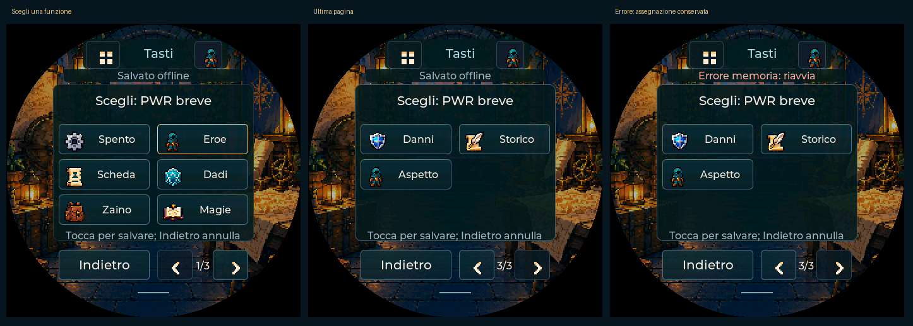

# PocketD-D v0.82 — dalla scheda alla sessione

29 ottobre 2026. Questa versione consolida l’uso offline e prepara la prova
USB. Le prove nuove usano esclusivamente dati sintetici. Nessuna lettura o
scrittura Beyond reale, nessuna modifica alla raccolta personale.

## 1. Sessione continua, salvataggi e riapertura

`firmware/tests/test_session.c` esegue le regole e lo storage di produzione:

| Momento | Risultato atteso e verificato |
| --- | --- |
| Inizio | PF 30/32, temporanei 3, due pozioni, tre torce |
| Attacco e danni tirati | Attacco 14, danni 5; PF e oggetti del PG invariati |
| Magia con concentrazione | Uno slot speso; concentrazione conservata |
| Danno ricevuto 11 | Temporanei 3 → 0, PF 30 → 22; unica salvezza COS 12 riuscita |
| Pozione e salvataggio interrotto | Scrittura/commit simulati falliscono: al riavvio resta la copia precedente |
| Riprova della stessa pozione | PF 22 → 26, pozioni 2 → 1; nessun nuovo lancio |
| Capacità e torcia | Un utilizzo e una torcia spesi; contatore manuale invariato |
| Riposo breve | Capacità recuperata; slot ordinari e concentrazione conservati |
| Dado vita | Cura 6, PF 32/32; un dado speso |
| Riposo lungo 2024 esplicito | Slot e dado recuperati, concentrazione terminata; oggetti consumati non ricreati |

Ogni salvataggio riuscito viene ricaricato attraverso lo storage nativo e
confrontato su tutti i campi persistenti, comprese preferenze, tasti e aspetto.
NVS è simulata in memoria con commit durevole: non prova interruzioni elettriche,
usura o affidabilità della flash fisica. Le azioni della UI rimangono coperte
dalla suite LVGL di produzione; questa sequenza aggiunge il controllo continuo
delle regole e della persistenza, senza presentarsi come una sessione fisica.

## 2. Scelta diretta dei tasti

Schermo → Tasti → tocca PWR breve, BOOT breve o BOOT lungo. Ora scegli la
funzione da un elenco con icone, sei opzioni per pagina. Le quindici funzioni
esistenti mantengono gli stessi identificativi e le vecchie assegnazioni.

Sfogliare e Indietro non salvano; la scelta corrente è evidenziata. Toccare
una funzione diversa salva e torna al riepilogo. Se la memoria fallisce,
resta la vecchia assegnazione; puoi riprovare o annullare. Le scorciatoie
e una nuova importazione non interrompono il selettore. PWR lungo rimane
riservato all’alimentazione. Nessun campo o formato persistente aggiunto.

## 3. Correggere la scheda dopo Beyond

Apri **Controlla dati e regole del PG** negli strumenti PC o in Al tavolo.
Il resoconto usa la scheda attuale, con accessi diretti a:

- caratteristiche, PF, CA, competenze e bonus;
- tiri ancora bloccati e sblocco manuale esplicito in Stato;
- tipi di danno conosciuti/sconosciuti e configurazione delle difese;
- arma attiva, inventario, magie, capacità, slot e contatori;
- generazione della copia USB e suoi eventuali limiti di capacità.

Dopo Salva o Annulla nell’editor, il controllo si aggiorna. Le altre schede
restano conservate. Un errore di quota mantiene la bozza aperta e i dati
precedenti. I tiri non si sbloccano solo perché modifichi un punteggio: la
verifica manuale resta esplicita. Le omissioni originali rimangono consultabili;
nessuna spunta globale dichiara risolte tutte le regole.

**Copia generabile** significa che il proiettore accetta la scheda nei limiti
del formato. Non prova correttezza di ogni regola D&D, equipaggiamento completo,
trasferimento o salvataggio sul dispositivo. Le descrizioni rimangono negli
estratti accettati. In guida l’invio resta nel passo Al tavolo, con la sua
conferma: il controllo non crea una seconda via per dichiararlo completato.

## 4. Diagnosi USB dal browser

Per la prova di stasera usa prima il percorso normale: invio, anteprima sul
Pocket e conferma sul display. Se fallisce, controlla il display e:

1. Nella stessa finestra apri **Altre opzioni USB e file** se sei nella guida.
2. Premi **Leggi diagnosi firmware** e scegli la porta del Pocket avviato.
3. Premi **Scarica report USB**, conservando anche l’esito del tentativo fallito.

La lettura invia soltanto la negoziazione e `PDD DIAGNOSTICS GET 1`, già
supportato dai firmware con diagnosi v1. Non invia il PG, non salva, non fa
reset o flash. Non viene aggiunta automaticamente all’importazione. Un firmware
vecchio, occupato, assente o con risposta non supportata resta un errore leggibile.

Il report testuale contiene al massimo gli ultimi quattro tentativi della
finestra: versione app, fasi, esiti, protocollo, VID/PID, conteggi dei log e
reset/fault riconosciuti. La versione firmware, memoria e stato dei servizi
si aggiungono solo dopo una risposta diagnostica conforme allo schema ammesso.
READY identifica il protocollo, non la versione firmware. Se questa non viene
letta il report lo dice. Una lettura riuscita non conferma un’importazione.

Sono esclusi JSON del PG, nomi, inventario, log integrali, seriale USB,
credenziali e cookie. Campi diagnostici sconosciuti o arbitrari vengono
rifiutati. Il report rimane locale finché scegli di scaricarlo; nessun invio
automatico. I tentativi si azzerano chiudendo la finestra.

## Verifiche e limiti

- 293 test JS, comprese diagnosi frammentate, schema/limiti, comandi di sola
  lettura, protocollo discordante e nessuna conferma su errore/cancellazione.
- Suite nativa completa e 127 viste LVGL: tutte le quindici funzioni dei tre
  tasti, annullamento, errore/riprova, protezione da eventi e nessuna scrittura
  quando la scelta è invariata.
- AddressSanitizer/UndefinedBehaviorSanitizer sulla UI e sulla nuova sessione;
  rilevamento leak disabilitato perché non supportato nell’ambiente.
- Browser su UI compilata: editor mirati, quota/cancel, verifiche esplicite,
  altre schede conservate, anteprima corrente, report USB esportato e larghezze
  1280/390/320. Servizi e USB sintetici, nessun account reale.
- Build ESP32-S3 e pacchetto Windows inclusivo di runtime ufficiale. Esecuzione
  Windows, USB, touch/tasti, SD, radio e alimentazione fisici restano da collaudare.

USB17 / backup PC20 / PDD36-PDDa e partizioni invariati. Il precedente flash
nero/ritorno a Elian non è dichiarato risolto. La sincronizzazione Beyond
sperimentale mantiene i limiti documentati, non viene resa obbligatoria.
