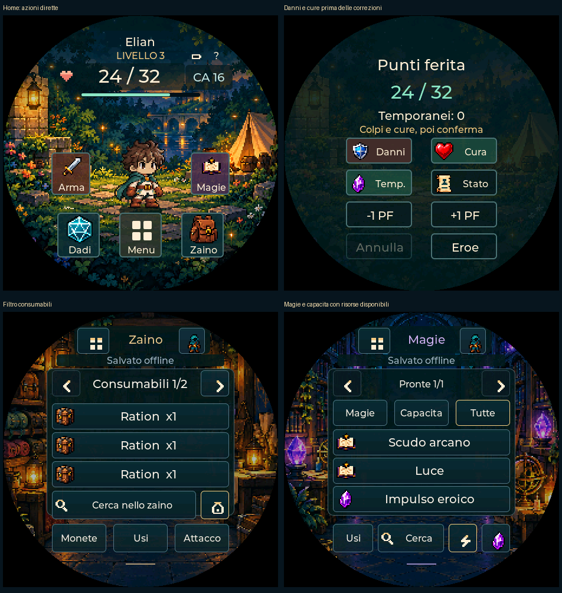

# PocketD-D — uso pratico sul dispositivo

Aggiornamento v0.85: [preparazione diretta, equipaggiamento con calcoli collegati,
True Strike e icone riconoscibili](EQUIPAGGIAMENTO-MAGIE.md).

Aggiornamento v0.82: [sessione continua, scelta diretta dei tasti e diagnosi USB](SESSIONE-V082.md). Le assegnazioni ora si scelgono da un elenco, senza scorrere una funzione per tocco.

29 ottobre 2026. Questa revisione mantiene l’avatar, gli ambienti e lo stile
approvati. Le schermate qui mostrate sono catture del firmware eseguito su PC
con dati sintetici, non fotografie né prove del touch fisico.

## Le azioni della home

- **Spada / Arma:** apre l’attacco con l’arma attiva. Se non c’è un’arma valida,
  apre lo zaino; non tira e non equipaggia automaticamente.
- **Libro / Magie:** apre magie e capacità. Dadi e zaino rimangono nel dock.
- **Cuore e PF:** apre Danni, Cura, temporanei e stato. Danni e Cura sono nella
  prima riga. Le correzioni manuali −1/+1 sono più in basso: non applicano tutte
  le difese e non sostituiscono il percorso Danni.
- **Quattro riquadri:** apre il menu. L’ingranaggio del menu porta a Schermo,
  da cui si raggiungono rete, tasti, alimentazione e backup. Rimane disponibile
  anche quando il menu segnala un errore di memoria.
- **Eroe in alto a destra:** torna direttamente alla home dalle schermate
  interne. È disabilitato durante conferme e tiri in corso.
- L’avatar apre ancora l’aspetto. I feedback PF rimangono sopra l’avatar,
  senza coprire i nuovi comandi laterali.

| Percorso dalla home | Prima | Ora |
| --- | --- | --- |
| Aprire l’attacco | Menu → Attacco: 2 tap | Spada / Arma: 1 tap |
| Aprire magie e capacità | Menu → Magie: 2 tap | Libro / Magie: 1 tap |
| Aprire Danni o Cura | PF → comando: 2 tap | Sempre 2 tap, con i due comandi in prima riga |
| Un d20 libero | Dadi → Lancia: 2 tap | Sempre 2 tap; le scorciatoie configurate restano disponibili |
| Tornare alla home da zaino o magie | Menu → Eroe: 2 tap | Icona Eroe: 1 tap |
| Pagine successive delle liste | Freccia per ogni pagina | Freccia oppure swipe laterale |

Questi conteggi terminano alla destinazione indicata. Aprire un attacco non
significa averlo tirato; aprire una magia non significa spenderne lo slot.
Anteprima, scelta dei costi e conferma restano nei percorsi che modificano il PG.

## Meno pagine da sfogliare

**Zaino:** l’icona della piccola borsa, accanto a Cerca, alterna tutte le voci e
**Consumabili**. Mostra oggetti portati a quantità positiva: cure, consumabili
e oggetti con cariche residue. Non equipaggia, consuma o ripristina niente.
Un oggetto a zero rimane consultabile nella vista completa.

**Magie:** il fulmine **Pronte** filtra per preparazione, utilizzi e slot
ordinari/patto disponibili di livello adeguato. Vale insieme alle schede
Magie/Capacità/Tutte e alla ricerca. Esclude le voci passive/informative.
È un filtro delle risorse: il comando finale continua a verificare gli altri
requisiti, compresi quelli situazionali. Non prepara magie automaticamente.
Il cristallo accanto apre le risorse magiche e la concentrazione.

Il bordo dorato segnala un filtro attivo. Tocca di nuovo la stessa icona per
ritornare all’elenco completo. Ricerca, filtri e pagine sono preferenze della
vista: niente scritture NVS e nessun cambiamento del personaggio. L’importazione
o il ripristino di una nuova scheda azzerano i filtri e le ricerche locali.

## Swipe, icone e tasti

Scorri **a sinistra** per la pagina successiva, **a destra** per la precedente
in zaino, magie, abilità e storico. Le frecce rimangono disponibili. Alle
estremità non si passa circolarmente alla prima/ultima pagina. Una gesture
riconosciuta consuma il rilascio: non apre una riga e non conferma operazioni.

**Premi a lungo un’icona** per leggerne il nome o il filtro. Il rilascio dopo
l’aiuto non esegue il comando. L’aiuto sparisce dopo due secondi e quando cambi
schermata. Le icone delle sezioni derivano dagli stessi disegni approvati;
menu, ricerca e frecce usano glifi pixel coerenti. Restano parole brevi dove
servono a distinguere azioni, costi e conferme.

Le assegnazioni **PWR breve, BOOT breve e BOOT lungo** restano conservate:
configurale in Schermo → Tasti per le tue sezioni più usate. Una scorciatoia
non supera le conferme protette e non interrompe un tiro generandone un altro.
PWR lungo rimane riservato all’alimentazione. Il test delle combinazioni
esistenti resta nella suite nativa; il comportamento elettrico va provato.

## Il PC come preparazione

Gli strumenti sono ordinati in **1 · Importa e personalizza**, **2 · Verifica
e trasferisci**, **3 · Conserva e collega**. Party, mappa e combattimento PC
rimangono sotto Altri strumenti e prototipi PC. Il ponte Beyond è opzionale.
Le azioni di importazione, configurazione, USB e backup mantengono i rispettivi
controlli e ogni pulsante principale compare una sola volta.

## Verifiche e limiti

- 283 test JavaScript; catalogo C con voci vuote/esaurite, livelli di slot,
  patto, preparazione, indici originali e intersezioni con la ricerca.
- 126 viste native; test tramite eventi pointer LVGL reali per i nuovi
  accessi, swipe, estremità, pressione lunga e protezione delle conferme.
- Catalogo e UI verificati con AddressSanitizer e UndefinedBehaviorSanitizer.
- Controlli browser PC su desktop, 390 e 320 pixel; navigazione e apertura
  importazione non cambiano la raccolta sintetica.
- Formati del PG invariati: USB17 / backup PC20 / PDD36-PDDa. Nessun nuovo
  campo nel personaggio, nessuna lettura o scrittura Beyond richiesta.

Restano aperti USB, touch/tasti fisici, fluidità, autonomia e prove reali del
ponte Beyond. Questa revisione non li dichiara risolti e non richiede una prova
USB adesso. Ulteriori aggiustamenti alla disposizione potranno seguire l’uso
sull’AMOLED reale.

