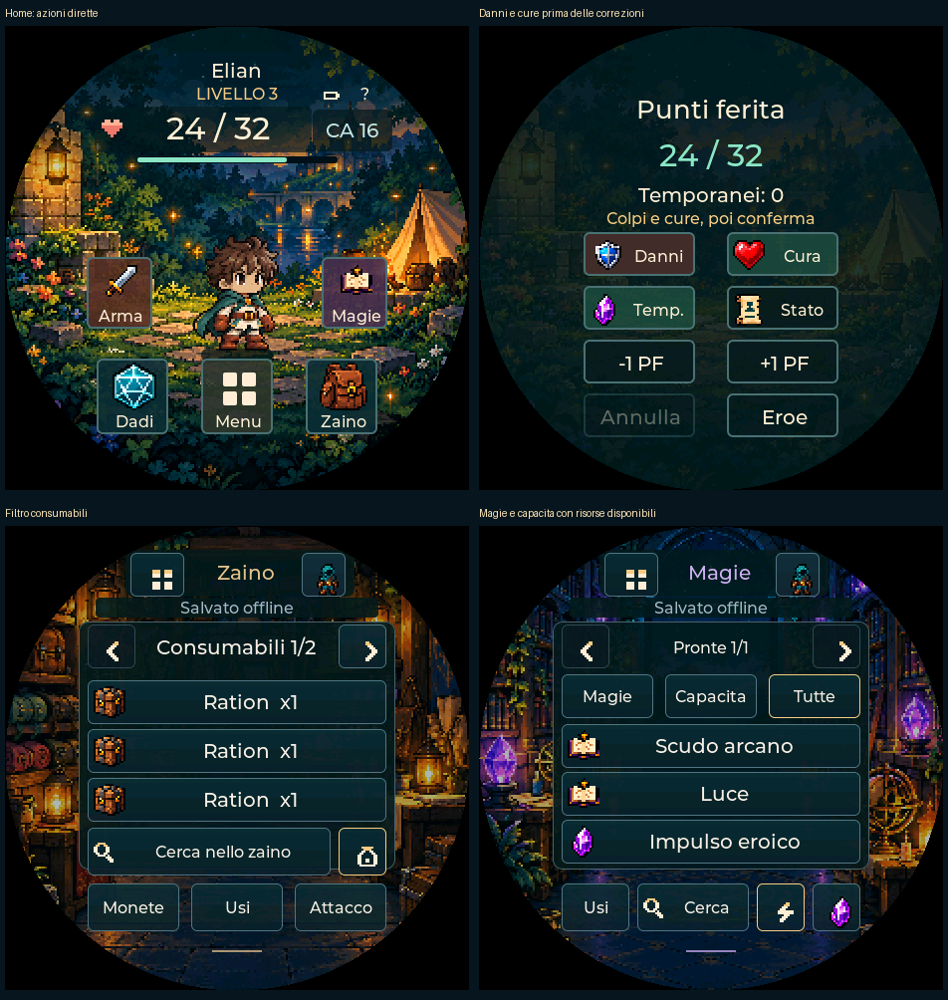

# PocketD-D — uso pratico sul dispositivo

> v0.100: [raccolta, personalizzazione diretta e impostazioni](UX-RPG.md#v0100-raccolta-aspetto-e-impostazioni).
>
> v0.99: [riserve dei dadi vita, condizioni ed effetti](UX-RPG.md#v099-riserve-condizioni-ed-effetti-locali).

> v0.98: [dotazione rapida, conferme e riposi](UX-RPG.md#v098-equipaggiamento-conferme-e-riposi).

> Aggiornamento v0.97: [risultati, dadi e schede di gioco](UX-RPG.md#seconda-iterazione--risultati-e-schede-di-gioco).

> Aggiornamento v0.96: [revisione UX del dispositivo](UX-RPG.md), prima iterazione.

> Aggiornamento v0.92: [collegamento account e scelta dei PG Beyond](COLLEGAMENTO-BEYOND.md). Nuovo percorso da collaudare realmente.
>
> Aggiornamento v0.91: [lettura e conversione Beyond sul Pocket via Wi-Fi](BEYOND-DISPOSITIVO.md), per ID pubblico; nuovo percorso da collaudare sull’hardware.
>
> Aggiornamento v0.90: [raccolta locale I miei PG sulla SD](LIBRERIA-LOCALE.md).

> Aggiornamento v0.89: [Punizione Divina 2024 e slot ibridi](PUNIZIONE-DIVINA.md).

> Aggiornamento v0.88: [Hex e Marchio 2024, bersaglio e danni collegati](EFFETTI-SUL-COLPO.md).
>
> Aggiornamento v0.87: [attacco normale o magia nel flusso di Attacca](ATTACCHI-CONTESTUALI.md).
>
> Aggiornamento v0.86: [bonus permanenti e sintonia per tutti i PG](OGGETTI-SINTONIA.md).

Aggiornamento v0.85: [preparazione diretta, equipaggiamento con calcoli collegati,
True Strike e icone riconoscibili](EQUIPAGGIAMENTO-MAGIE.md).

Aggiornamento v0.82: [sessione continua, scelta diretta dei tasti e diagnosi USB](SESSIONE-V082.md). Le assegnazioni ora si scelgono da un elenco, senza scorrere una funzione per tocco.

29 ottobre 2026. Questa revisione mantiene l’avatar, gli ambienti e lo stile
approvati. Le schermate qui mostrate sono catture del firmware eseguito su PC
con dati sintetici, non fotografie né prove del touch fisico.

## Le azioni della home

- **Spada / Arma:** apre direttamente l’attacco con l’arma attiva. Se il PG ha una variante
  numerica compatibile, arma e magia sono nella stessa schermata. **Varianti**
  apre il catalogo completo delle origini e degli effetti contestuali. Se manca l’arma, apre scelta/configurazione;
  non tira e non equipaggia automaticamente.
- **Libro / Magie:** apre magie e capacità. Dadi e zaino rimangono nel dock.
- **Cuore e PF:** apre Danni, Cura, temporanei e stato. Danni e Cura sono nella
  prima riga. Le correzioni manuali −1/+1 sono in **Correggi**: non applicano tutte
  le difese e non sostituiscono il percorso Danni.
- **Quattro riquadri:** apre il menu. L’ingranaggio del menu porta a Schermo,
  da cui si raggiungono rete, tasti, alimentazione e backup. Rimane disponibile
  anche quando il menu segnala un errore di memoria.
- **Eroe in alto a destra:** torna direttamente alla home dalle schermate
  interne. È disabilitato durante conferme e tiri in corso.
- L’avatar apre ancora l’aspetto. I feedback PF rimangono sopra l’avatar,
  senza coprire i nuovi comandi laterali.

| Percorso dalla home | Prima | Ora |
| --- | --- | --- |
| Aprire l’attacco | Menu → Attacco: 2 tap | Spada / Arma: 1 tap |
| Aprire magie e capacità | Menu → Magie: 2 tap | Libro / Magie: 1 tap |
| Aprire Danni o Cura | PF → comando: 2 tap | Sempre 2 tap, con i due comandi in prima riga |
| Un d20 libero | Dadi → Lancia: 2 tap | Sempre 2 tap; le scorciatoie configurate restano disponibili |
| Tornare alla home da zaino o magie | Menu → Eroe: 2 tap | Icona Eroe: 1 tap |
| Pagine successive delle liste | Freccia per ogni pagina | Freccia oppure swipe laterale |

Questi conteggi terminano alla destinazione indicata. Dalla v0.96 l’attacco
ordinario richiede due tap dalla home al tiro, anche con varianti disponibili.
La scelta rapida di una magia compatibile aggiunge un tap nella stessa schermata;
altre origini ed effetti restano in **Varianti**. Aprire un attacco non
significa averlo tirato; aprire una magia non significa spenderne lo slot.
Anteprima, scelta dei costi e conferma restano nei percorsi che modificano il PG.

## Meno pagine da sfogliare

**Zaino:** l’icona della piccola borsa, accanto a Cerca, alterna tutte le voci e
**Consumabili**. Mostra oggetti portati a quantità positiva: cure, consumabili
e oggetti con cariche residue. Non equipaggia, consuma o ripristina niente.
Un oggetto a zero rimane consultabile nella vista completa.

**Magie:** il fulmine **Pronte** filtra per preparazione, utilizzi e slot
ordinari/patto disponibili di livello adeguato. Vale insieme alle schede
Magie/Capacità/Tutte e alla ricerca. Esclude le voci passive/informative.
È un filtro delle risorse: il comando finale continua a verificare gli altri
requisiti, compresi quelli situazionali. Non prepara magie automaticamente.
Il cristallo accanto apre le risorse magiche e la concentrazione.

Il bordo dorato segnala un filtro attivo. Tocca di nuovo la stessa icona per
ritornare all’elenco completo. Ricerca, filtri e pagine sono preferenze della
vista: niente scritture NVS e nessun cambiamento del personaggio. L’importazione
o il ripristino di una nuova scheda azzerano i filtri e le ricerche locali.

## Swipe, icone e tasti

Scorri **a sinistra** per la pagina successiva, **a destra** per la precedente
in zaino, magie, abilità e storico. Le frecce rimangono disponibili. Alle
estremità non si passa circolarmente alla prima/ultima pagina. Una gesture
riconosciuta consuma il rilascio: non apre una riga e non conferma operazioni.

**Premi a lungo un’icona** per leggerne il nome o il filtro. Il rilascio dopo
l’aiuto non esegue il comando. L’aiuto sparisce dopo due secondi e quando cambi
schermata. Le icone delle sezioni derivano dagli stessi disegni approvati;
menu, ricerca e frecce usano glifi pixel coerenti. Restano parole brevi dove
servono a distinguere azioni, costi e conferme.

Le assegnazioni **PWR breve, BOOT breve e BOOT lungo** restano conservate:
configurale in Schermo → Tasti per le tue sezioni più usate. Una scorciatoia
non supera le conferme protette e non interrompe un tiro generandone un altro.
PWR lungo rimane riservato all’alimentazione. Il test delle combinazioni
esistenti resta nella suite nativa; il comportamento elettrico va provato.

## Il PC come preparazione

Gli strumenti sono ordinati in **1 · Importa e personalizza**, **2 · Verifica
e trasferisci**, **3 · Conserva e collega**. Party, mappa e combattimento PC
rimangono sotto Altri strumenti e prototipi PC. Il ponte Beyond è opzionale.
Le azioni di importazione, configurazione, USB e backup mantengono i rispettivi
controlli e ogni pulsante principale compare una sola volta.

## Verifiche e limiti

- 283 test JavaScript; catalogo C con voci vuote/esaurite, livelli di slot,
  patto, preparazione, indici originali e intersezioni con la ricerca.
- 126 viste native; test tramite eventi pointer LVGL reali per i nuovi
  accessi, swipe, estremità, pressione lunga e protezione delle conferme.
- Catalogo e UI verificati con AddressSanitizer e UndefinedBehaviorSanitizer.
- Controlli browser PC su desktop, 390 e 320 pixel; navigazione e apertura
  importazione non cambiano la raccolta sintetica.
- Formati del PG invariati: USB17 / backup PC20 / PDD36-PDDa. Nessun nuovo
  campo nel personaggio, nessuna lettura o scrittura Beyond richiesta.

Restano aperti USB, touch/tasti fisici, fluidità, autonomia e prove reali del
ponte Beyond. Questa revisione non li dichiara risolti e non richiede una prova
USB adesso. Ulteriori aggiustamenti alla disposizione potranno seguire l’uso
sull’AMOLED reale.

## Risultato del tiro · v0.97

Numero grande in alto, esito sotto e dadi al centro. Prima della fine del volo il
numero non viene anticipato. **Accelera** o il tocco sul dado rivelano lo stesso
tiro. Dopo un colpo riuscito **Danni** è il comando principale; dopo un mancato,
**Nuovo** apre un altro attacco. Non vengono ritirati automaticamente i dadi.

Per danni con più componenti il numero grande resta il totale complessivo;
la riga sopra identifica la componente visualizzata. **Radianti / Extra /
Punizione / Dadi arma** cambiano la vista dello stesso tiro. Cure e cariche
mostrano la quantità effettivamente guadagnata, anche quando il tiro supera il
massimo. I dettagli del tiro rimangono nello **Storico**.

In basso: icone Eroe, Scheda, Storico e Usi, con nome su pressione prolungata.
Nella scheda magia tocca il riquadro del nome per leggere il testo esteso.
**Effetti manuali** significa che le conseguenze vanno ancora gestite con il DM.

## Dotazione e recuperi · v0.98

Nello zaino, la **tunica** accanto a un’arma o a un oggetto con profilo apre
Equipaggia/Riponi. Il bordo dorato indica la dotazione attiva. Controlla i valori
prima/dopo e premi **Conferma**: ritorni allo stesso elenco. Toccare il nome
continua ad aprire la scheda. Oggetti senza profilo si configurano dalla scheda;
non acquisiscono bonus solo perché l’icona sembra un’armatura.

**Dettagli / Riepilogo** cambia solo la vista della bozza. **Indietro** la annulla;
nessuna risorsa viene consumata. La conferma di una magia distingue slot ordinari
e patto, eventuali utilizzi innati, PF e concentrazione. Se sostituisce una magia
che sostiene bonus, i dettagli mostrano anche CA e massimi risultanti.

Nel riposo lungo scegli direttamente **Manuale**, **2014** o **2024** per i dadi
vita. La scelta 2014 mantiene la selezione esplicita dei dadi da recuperare.
Cambiando regola si azzera quella selezione nella bozza. Il riepilogo separa
slot ordinari e patto; i dati assenti restano indicati come non disponibili.

## Riposo breve, condizioni ed effetti · v0.99

Dopo il riposo breve scegli direttamente una riserva fra le tre mostrate;
le frecce danno accesso a tutte le classi/riserve. Controlla il dado e il costo,
poi Conferma. La selezione non tira né spende. **Riprova** dopo un errore salva
lo stesso tiro. **Spendi un dado vita** conserva anche il percorso classico.

**Stato** mostra i comandi per condizioni, effetti locali, morte, danni, tempo,
reazione e usi. Una condizione annotata conserva nome, icona e livello; resta
una **nota**. **Condizioni → Tiri** modifica separatamente i quattro stati
meccanici supportati, dopo anteprima/conferma. Avvelenato ha ancora il proprio
comando da Stato. Un’icona non aggiunge regole al PG.

Negli effetti locali, **pausa**, **scaduto**, durata e **C** (concentrazione) sono
separati dal valore. **1 round** apre l’anteprima delle scadenze; non avanza nulla
finché non confermi. CA e PF possono diminuire alla fine di un bonus: controlla
il confronto prima/dopo. Ore e minuti sono presentati nell’unità corretta.

## Raccolta e personalizzazione · v0.100

`I miei PG` mostra livello e copia attuale. Tocca un nome, controlla avatar,
PF e CA, poi `Apri e gioca`; `Indietro` lascia il PG attuale. La SD conserva le
copie secondo le regole già presenti. Da Beyond consulta anche `Limiti e dati
manuali` prima di `Importa`; senza SD la schermata avvisa della sostituzione.

Per l’aspetto: `Modifica > Campi > Specie / Silhouette / Classe` oppure `Sfondo`.
Le modifiche restano in bozza fino ad `Anteprima > Conferma`; `Annulla` le scarta.
I look di classe hanno colori fissi. PWR seleziona, BOOT attiva, BOOT lungo torna
indietro; nel selettore dei campi torna prima all’editor. Le assegnazioni dei
tasti di gioco restano conservate.

`Schermo` raccoglie luminosità, attenuazione e accessi a Wi-Fi, energia, tasti e
backup. Aprirlo non accende il Wi-Fi e non modifica la scheda.
