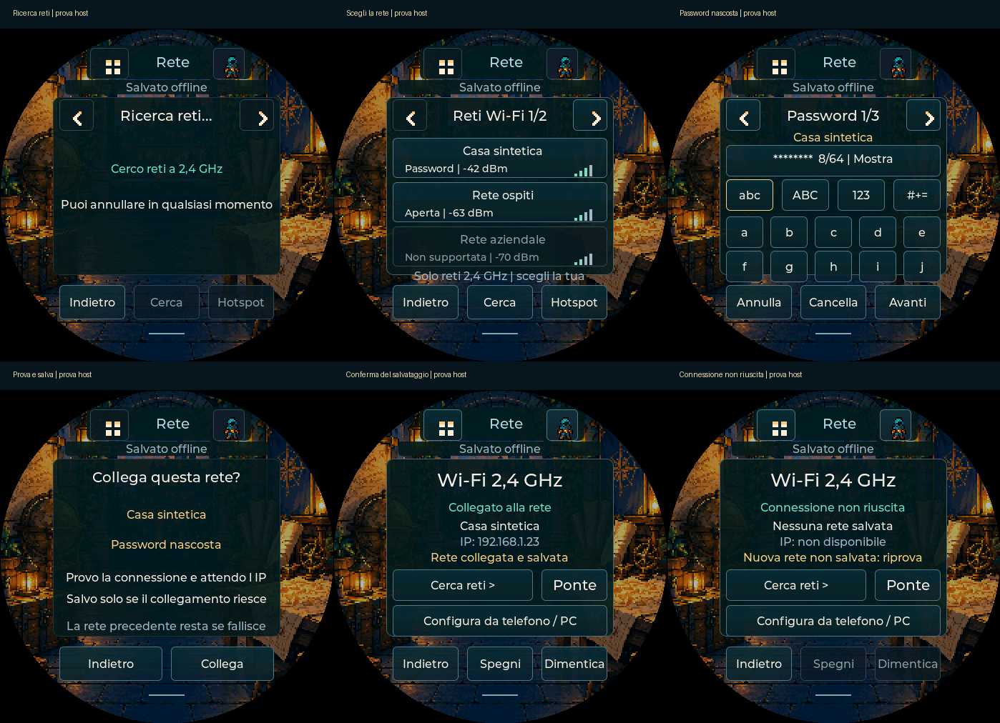

# Wi-Fi sul dispositivo — v0.84

Wi-Fi **2,4 GHz** opzionale. La scheda funziona offline. Il firmware parte con
radio spenta se non è stata salvata e abilitata una rete. Wi-Fi collegato non
prova una sincronizzazione. Dalla v0.79 è disponibile il [ponte sperimentale
Beyond](PONTE-BEYOND.md), con abbinamento separato e conferma sul display;
l’importazione autonoma dal dispositivo resta successiva.

## Configurazione direttamente dal Pocket

Con firmware **0.84** non serve un telefono o il PC per scegliere la rete:

1. **Menu → ingranaggio → Wi-Fi → Cerca reti** (oppure Aspetto → Schermo → Wi-Fi).
2. Attendi la ricerca e tocca la tua rete. Le reti sono ordinate per segnale,
   con indicazione Password/Aperta/Non supportata. Le frecce scorrono le pagine;
   Cerca aggiorna l’elenco. Sono mostrate fino a 16 reti distinte più forti.
3. Inserisci la password: **abc / ABC / 123 / #+=** cambiano il gruppo, la freccia
   destra cambia pagina dei tasti. Cancella rimuove l’ultimo carattere. Tocca
   il campo nascosto per mostrare/nascondere il testo; quello lungo scorre.
4. **Avanti → Collega** prova la rete. Per una rete aperta compare una conferma
   esplicita, senza inventare una password.
5. Attendi **Rete collegata e salvata**. Connessione in corso e IP ottenuto non
   equivalgono da soli al salvataggio: un errore NVS è indicato separatamente.

Annulla elimina la password in bozza. La rete precedente resta memorizzata se
la prova fallisce; se era abilitata viene riprovata. Senza una rete precedente
abilitata e senza portale aperto, una prova fallita spegne la radio.
SSID nascosti: usa **Hotspot** o **Configura da telefono / PC** per inserirli
manualmente. Il ponte Beyond si abbina ancora dal portale separato.

Tasti nella ricerca/tastiera/conferma: PWR breve scorre il controllo evidenziato,
BOOT breve lo attiva, BOOT lungo torna indietro. In queste schermate le scorciatoie
personali sono temporaneamente protette; assegnazioni e scheda non cambiano.
Tutti i bersagli hanno altezza minima 44 px e restano entro il cerchio.

## Configurazione alternativa da telefono o PC

1. Sul Pocket: **Aspetto → Schermo → Wi-Fi → Configura da telefono / PC**.
2. Sul telefono/PC connettiti alla rete **PocketDD-…**. La password temporanea
   è sul display. Se il telefono segnala assenza di Internet, resta connesso.
3. Apri **http://192.168.4.1** nel browser. Inserisci SSID e password della
   rete di casa a 2,4 GHz, poi **Prova e salva la rete**.
4. Attendi la conferma di rete collegata e salvata sul portale/display.
   Il solo invio del modulo non è una conferma. Con password errata riprova;
   nome e password della precedente rete salvata restano conservati se la
   nuova connessione non riesce.
5. Torna alla rete abituale del telefono/PC. Il portale si chiude entro cinque
   minuti; la connessione salvata resta attiva. Al riavvio viene riprovata.

Non è necessario che il PC resti acceso per configurare il Wi-Fi. Puoi usare
**Spegni** per interrompere connessione e portale; la rete resta memorizzata,
con riaccensione esplicita da **Accendi**. **Dimentica → Conferma** cancella la
configurazione Wi-Fi, conservando scheda, aspetto e backup del personaggio.
I tasti configurabili continuano a navigare i controlli dell’interfaccia.

Supportati WPA2/WPA3-Personal e rete aperta con conferma esplicita.
Password 8–63 caratteri ASCII oppure PSK esadecimale di 64; SSID UTF-8 fino a
32 byte. Reti solo 5 GHz, enterprise e accessi tramite portale pubblico non
sono supportati. Le reti nascoste non compaiono nella scansione; il modulo del portale consente SSID manuali.

## Errori e sospensione

“Collegato” indica un indirizzo IP locale ottenuto, non una prova di accesso
Internet/Beyond. Un errore di memoria indica **salvataggio non confermato**:
controlla il dispositivo prima di riavviare. Non viene dichiarato successo
per il solo collegamento radio. Dopo un errore resta disponibile il gioco offline.

Tre tentativi entro circa 30 secondi per una connessione; una disconnessione
successiva riapre il ciclo. La sospensione arresta prima radio e portale,
aspettando la conferma del servizio; al risveglio riprende la rete salvata solo
se prima era richiesta. Il portale non viene riaperto automaticamente.
Una radio che non si arresta impedisce la sospensione anziché simulare uno
spegnimento riuscito. Anche prima dello spegnimento PMIC viene richiesta la pausa.

## Memoria e riservatezza

Configurazione in `pdd_nvs`, namespace **pdd_wifi**, chiave `config`;
completamente distinta da `pdd_state` e dalle schede. Nessuna credenziale entra
in JSON del PG, diagnostica, storico, backup o pacchetti pubblicati.
La memoria NVS della build non è cifrata: non protegge da lettura fisica della flash.

Le nuove credenziali vengono salvate solo dopo la connessione alla rete
corrispondente e l’ottenimento dell’IP, mai al ricevimento del modulo. Nessuna
cancellazione globale NVS. Il driver usa solo RAM per le proprie impostazioni,
con NVS SDK disabilitata esplicitamente: la partizione di default non serve.

Portale temporaneo WPA2 con password casuale di 16 caratteri, token del modulo,
controlli Host/Origin e ricezione solo dall’interfaccia AP. Nessun servizio di
configurazione disponibile dalla LAN domestica. Le password non vengono
stampate nei log né ripresentate dal server. Il passaggio SAR/RF della sorgente
casuale è serializzato con i tiri; la sorgente offline ritorna dopo arresto RF.

## Cosa è provato

Compilazione ESP-IDF per la scheda standard 1.75. Parser dei dati del portale,
20.000 corpi malformati, portale nel browser con backend simulato, 131 viste LVGL e servizio di produzione con SDK
simulato: errori d’inizializzazione/start/stop, autenticazione del modulo,
scadenza, fallback, NVS fallita, pause confermate, riaggancio e separazione dei
namespace. Queste sono prove software, **non prove della radio o della NVS reale**.

La ricerca usa `esp_wifi_scan_start` asincrona, con limite di 15 secondi e
raccolta fino a 64 record SDK; deduplica SSID/tipo di sicurezza, ordina per RSSI
e conserva le prime 16 reti. Reti vuote, SSID non rappresentabili, enterprise e
sicurezza non supportata non diventano connessioni automatiche. Scansione da
radio spenta la riporta spenta; una connessione esistente resta richiesta.
I buffer del driver sono liberati; scansione e prova si interrompono in pausa.

Nuove prove con SDK simulato: segnali/duplicati/limiti, annullamento, completamento
ritardato dopo annullamento, avvio fallito, timeout, errore scansione, mantenimento
connessione e credenziali, copia della password, DHCP coerente prima della NVS,
password errata e NVS fallita, rete aperta e pausa/riaggancio. UI: tutti i 95
caratteri ASCII stampabili, bozza nascosta, conferma, annullamento, limite 64 byte,
tasti fisici e PG/RNG/salvataggi invariati. ASAN/UBSAN sul servizio e sulla UI;
leak detector escluso per i limiti dell’ambiente. Nessun test usa reti personali.

Sul tuo hardware restano da verificare ricerca, collegamento, password errata, riavvio,
sospensione/risveglio, dimentica rete e consumo. Non sostituiscono il collaudo
USB/SD e persistenza del PG: l’utente ha riferito riuscita la prima importazione, gli altri controlli restano aperti.
