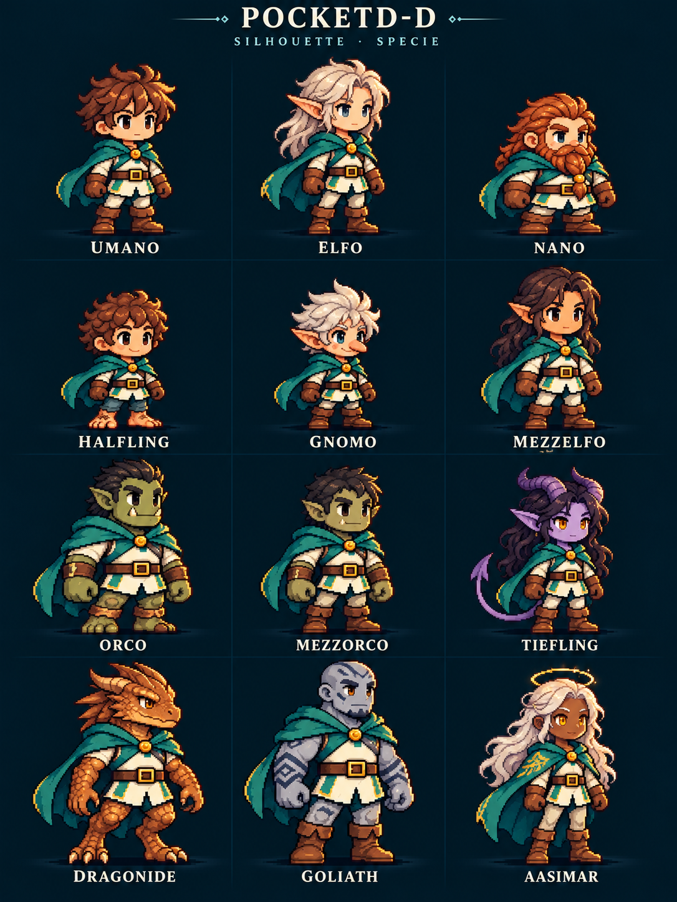

# Silhouette e specie — proposta visiva

Tavola originale del 27 ottobre 2026, nello stile dell'avatar approvato di
PocketD-D. Le dodici proposte sono: Umano, Elfo, Nano, Halfling, Gnomo,
Mezzelfo, Orco, Mezzorco, Tiefling, Dragonide, Goliath e Aasimar.

L'abbigliamento comune rende confrontabili anatomie e proporzioni. Le piccole
specie mantengono una statura inferiore; orecchie, corporatura, corna, coda,
muso draconico e tratti celestiali distinguono gli esempi. Colori, capelli e
presentazione di ogni figura sono scelte illustrative, non caratteristiche
dedotte da un personaggio Beyond.

**Questa è una proposta di stile, non un foglio sprite pronto per il firmware.**
Il PNG originale rimane integro, con hash, riferimento e riepilogo della richiesta
in [provenance.json](provenance.json). Non contiene dati di PG reali.

Prima dell'integrazione servono figure trasparenti normalizzate, punto d'appoggio
coerente, verifica della leggibilità alle dimensioni del dispositivo e pose di
battito/cura/danno. La tavola non certifica ancora queste proprietà.

L'obiettivo successivo è proporre la silhouette dalla specie sorgente durante
l'importazione Beyond, mostrarla nell'anteprima e permetterne la modifica.
Specie sconosciute/homebrew richiederanno una scelta dichiarata. Le schede
esistenti conserveranno l'aspetto attuale. Il firmware 0.66 e l'importatore
non cambiano comportamento con questo incremento grafico.
